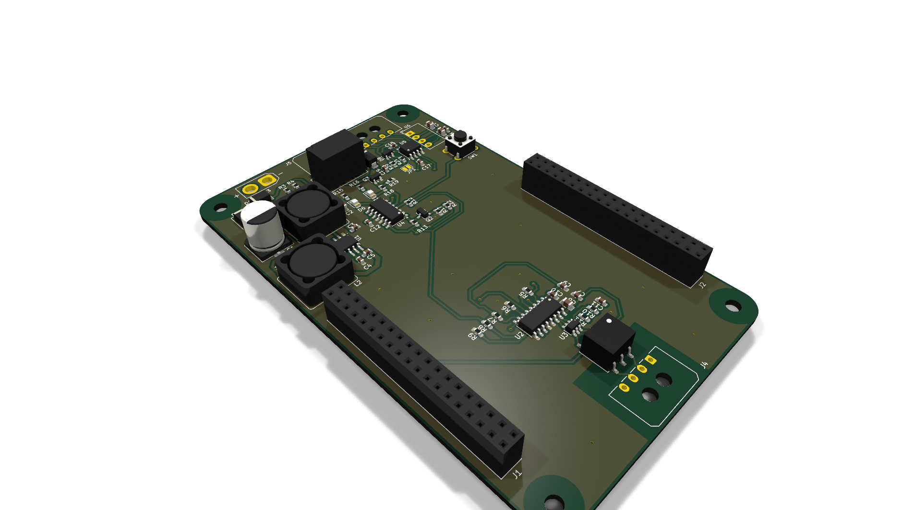
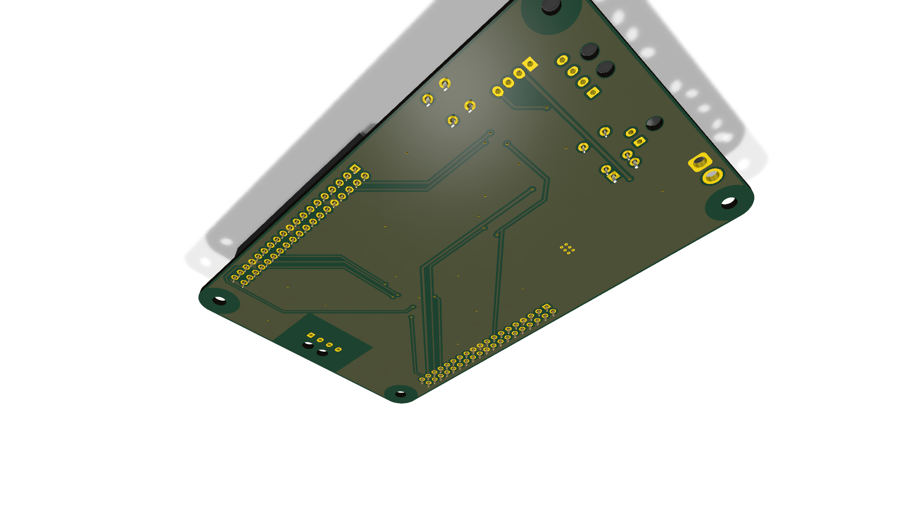
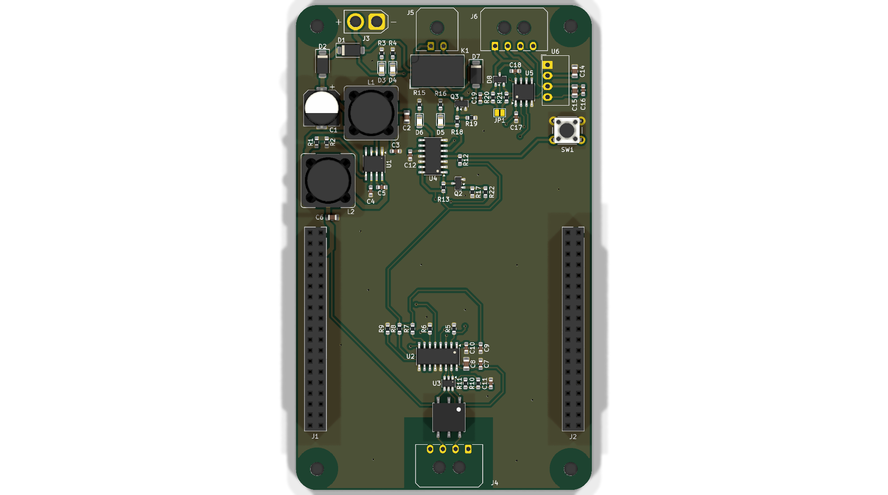
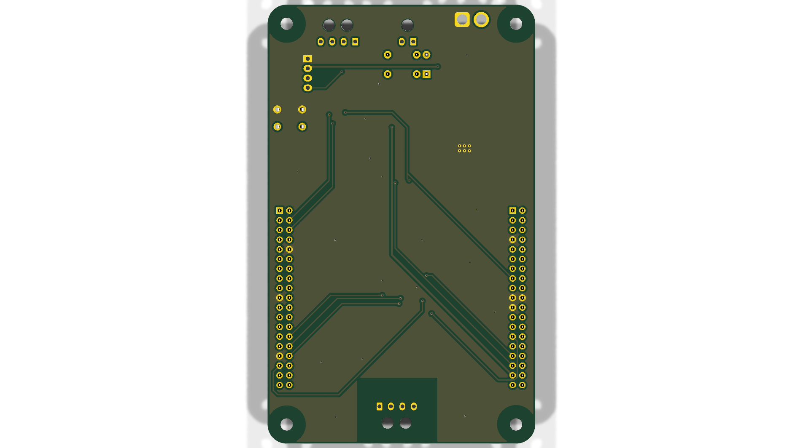
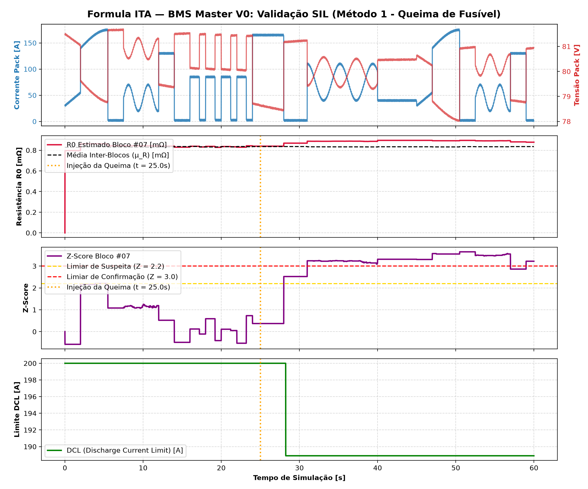

# BMS Master — STM32 Nucleo G474RE (Formula ITA)
### ECU Central de Gerenciamento do Acumulador de Tração (20s18p)

Repositório oficial e unificado (**Monorepo**) de **Hardware**, **Firmware** e **Documentação de Engenharia** do BMS Master desenvolvido para o protótipo Formula SAE Electric da equipe **Formula ITA** (Temporada 2025-2026).

---

## Renderização 3D da Carrier Board

A placa **BMS Master Carrier Shield** é uma PCB de 4 camadas projetada para acoplar o núcleo de processamento **ST NUCLEO-G474RE** via conectores Morpho, integrando circuitos de proteção automotiva, barreira galvânica e interface com o circuito de segurança (SDC).

<div align="center">
  
  <p><em>Vista Isométrica Superior — Destaque para o transformador de pulso Pulse HMU2103NL (Iso-SPI), relé automotivo TE do SDC, regulador buck automotivo e conectores Molex Micro-Fit.</em></p>
</div>

<br>

### Galeria de Vistas 3D (KiCad 10 Raytracing)

| Perspectiva Superior (Iso Top) | Perspectiva Inferior (Iso Bottom) |
| :---: | :---: |
|  |  |
| **Vista Ortográfica Superior (Top View)** | **Vista Ortográfica Inferior (Bottom View)** |
|  |  |

---

## Destaques do Projeto de Hardware

* **Topologia do Acumulador:** 20 blocos em série, cada bloco com 18 células em paralelo (**20s18p = 360 células** formato 21700).
* **Processamento Central:** ST NUCLEO-G474RE (MCU ARM Cortex-M4F com FPU a 170 MHz, 512 kB Flash, 128 kB SRAM).
* **Barreira de Isolação Iso-SPI (FSAE EV4.8):** Transceptor ST `L99BM1TR` acoplado a transformador de isolação `Pulse HMU2103NL` ($\ge 2500\text{ V}_{RMS}$, creepage $\ge 4{,}0\text{ mm}$).
* **Interface SDC Hardware Latch:** Circuito biestável puramente em hardware com reset supervisionado, garantindo abertura mandatória da linha de shutdown em qualquer falha crítica.
* **Alimentação e Proteção GLV:** Buck automotivo `TI LMR36510` (12V $\to$ 5V) com supressor TVS SMAJ, diodo Schottky contra inversão de polaridade e filtragem para normas ISO 7637-2.
* **Comunicação Veicular:** CAN-FD isolada galvanicamente via transceptor `TI ISO1042` (suporte a até 5 Mbps).

---

## Estrutura do Repositório (Monorepo)

```text
BMS Master - STM - V0/
├── docs/                        # Engenharia de sistemas, especificações e relatórios técnicos
│   ├── PLANO_MESTRE_BMS_MASTER_CONSOLIDADO.md  # Especificação técnica completa do sistema
│   ├── RELATORIO_AUDITORIA_SENIOR_JUIZ_FSAE.md # Auditoria de conformidade com regras FSAE EV
│   ├── MANUAL_OPERACIONAL_E_MONTAGEM_BMS.md    # Procedimentos de montagem, testes e comissionamento
│   ├── PLANO_DETECCAO_FUSIVEL_METODO_1.md      # Formulação matemática do algoritmo RLS e Z-score
│   ├── GUIA_ENSAIO_CARACTERIZACAO_CELULAS_21700.md # Manual de bancada HPPC (FreedomCAR)
│   └── ARQUITETURA_E_PLANEJAMENTO_BMS_MASTER.md    # Arquitetura conceitual e interfaces
│
├── firmware/                    # Código em C99 Puro (ARM Cortex-M4F & Simulação SIL)
│   ├── core/                    # Algoritmos puros desacoplados de hardware
│   │   ├── bms_types.h          # Definições da topologia 20s18p, limites e telemetria
│   │   ├── alg_fuse_detect.c/.h # RLS incremental, Z-score e Pre-Flight Check de fusíveis
│   │   ├── alg_soc.c/.h         # Coulomb counting, tabela OCV e limites CCL/DCL dinâmicos
│   │   └── fsm_master.c/.h      # Máquina de estados finitos (FSAE EV4.8 / EV8)
│   ├── mock/                    # Motor de sensoriamento sintético de alta fidelidade
│   │   ├── bms_mock_battery.c/.h# Modelo eletrotérmico Thévenin 1RC (Samsung 21700)
│   │   └── drive_cycle.c/.h     # Perfil de corrida FSAE sem regeneração (frenagem mecânica)
│   ├── tests_sil/               # Testes de Software-in-the-Loop (SIL) no Host (PC)
│   │   ├── main_sil_runner.c    # Simulação temporal de 60s com injeção de faltas programadas
│   │   ├── sil_telemetry_log.csv# Log temporal com 6.000 amostras
│   │   └── sil_telemetry_plot.png # Gráfico consolidado da telemetria de simulação
│   ├── tools/                   # Ferramentas de análise e simulação
│   │   ├── sim_runner.py        # Simulador interativo em Python
│   │   └── plot_telemetry.py    # Gerador de gráficos da telemetria SIL
│   └── Makefile                 # Build para Clang/GCC Host e ARM Toolchain
│
├── hardware/                    # Projeto Eletrônico no KiCad 10
│   └── carrier_shield/          # Carrier Board de 4 camadas para NUCLEO-G474RE
│       ├── bms_carrier_shield.kicad_pro  # Projeto mestre KiCad
│       ├── bms_carrier_shield.kicad_sch  # Esquemático hierárquico
│       ├── bms_carrier_shield.kicad_pcb  # Layout de 4 camadas (Top/GND/PWR/Bot)
│       ├── bms_master_schematic.pdf      # Esquemático completo em PDF vetorial
│       ├── 01_power_supply.kicad_sch     # Folha: Regulador GLV 12V -> 5V
│       ├── 02_isospi_barrier.kicad_sch   # Folha: Barreira Iso-SPI L99BM1TR + HMU2103NL
│       ├── 03_sdc_latch.kicad_sch        # Folha: Circuito Latch biestável do SDC
│       ├── 05_canfd_interface.kicad_sch  # Folha: Interface CAN-FD isolada ISO1042
│       ├── 06_nucleo_headers.kicad_sch   # Folha: Conectores Morpho NUCLEO-G474RE
│       └── libraries/                    # Modelos 3D (.stp/.wrl), símbolos e footprints
│
├── renders/                     # Renderizações fotorrealistas em alta resolução da PCB
│   ├── master_render_iso_top.png
│   ├── master_render_iso_bottom.png
│   ├── master_render_top.png
│   └── master_render_bottom.png
│
└── simulation/                  # Simulação de circuitos analógicos (Proteus VSM)
    └── proteus_sdc_precharge/   # Circuito biestável SDC e transitório RC de pré-carga
```

---

## Software-in-the-Loop (SIL) & Validação de Algoritmos

O firmware foi projetado segundo a arquitetura de **Core Desacoplado**, permitindo que 100% dos algoritmos de segurança, estimativa de estado e detecção de anomalias sejam validados no computador host antes do deployment no microcontrolador:

1. **Detecção de Fusível Rompido via RLS:** Estima recursivamente a resistência interna $\hat{R}_i$ de cada bloco em tempo real durante a descarga ($0{,}833\text{ m}\Omega \to 0{,}882\text{ m}\Omega$, delta de $+49\ \mu\Omega$).
2. **Estimador de SOC Híbrido:** Integração Coulomb Counting compensada por OCV relaxado com limites dinâmicos de corrente de carga (CCL) e descarga (DCL).
3. **FSM Conforme FSAE:** Transições estritas entre `BOOT`, `PRECHARGE`, `DRIVE`, `CHARGING`, `FAULT` e travamento por Latch em caso de violação de envelope seguro.

<div align="center">
  
  <p><em>Curvas de resposta dinâmica: Corrente do perfil de corrida, tensões das células, evolução da resistência estimada por RLS com injeção de falha aos 20s e transições de estado da FSM.</em></p>
</div>

### Executando a Simulação SIL Localmente

No terminal, dentro do diretório `firmware/`:

```powershell
# 1. Compilar e rodar a simulação SIL nativa em C (60 segundos virtuais a 100 Hz)
clang -O2 -Wall -Icore -Imock tests_sil/main_sil_runner.c core/alg_fuse_detect.c core/alg_soc.c core/fsm_master.c mock/bms_mock_battery.c mock/drive_cycle.c -o tests_sil/sil_runner.exe -lm
.\tests_sil\sil_runner.exe

# 2. Gerar/atualizar os gráficos de telemetria
python tools/plot_telemetry.py
```

---

## Como Abrir o Projeto Eletrônico no KiCad 10

1. Abra o **KiCad 10**.
2. Selecione **Abrir Projeto** e aponte para:  
   `hardware/carrier_shield/bms_carrier_shield.kicad_pro`.
3. Para visualizar a placa em 3D:
   - Abra o editor de PCB (`bms_carrier_shield.kicad_pcb`).
   - Pressione <kbd>Alt</kbd> + <kbd>3</kbd> para abrir o **Visualizador 3D**.
   - As bibliotecas de modelos (`libraries/3dmodels/`) já estão configuradas relativamente no projeto.

---

## Documentação Técnica de Referência

Consulte a pasta [`docs/`](docs/) para aprofundamento técnico:
* [**Plano Mestre Consolidado**](docs/PLANO_MESTRE_BMS_MASTER_CONSOLIDADO.md) — Documento mestre de especificação técnica e funcional.
* [**Relatório de Auditoria FSAE EV**](docs/RELATORIO_AUDITORIA_SENIOR_JUIZ_FSAE.md) — Parecer técnico de conformidade com os artigos do regulamento FSAE.
* [**Manual Operacional e de Montagem**](docs/MANUAL_OPERACIONAL_E_MONTAGEM_BMS.md) — Roteiro detalhado de fabricação, montagem de chicotes e testes de bancada.
* [**Plano de Detecção de Fusível Rompido**](docs/PLANO_DETECCAO_FUSIVEL_METODO_1.md) — Formulação matemática do RLS incremental e teste Z-score.
* [**Guia de Caracterização de Células 21700**](docs/GUIA_ENSAIO_CARACTERIZACAO_CELULAS_21700.md) — Protocolo de ensaio experimental HPPC em bancada.

---

<div align="center">
  <sub>Formula ITA — Equipe de Formula SAE Elétrico do Instituto Tecnológico de Aeronáutica (ITA).</sub>
</div>
