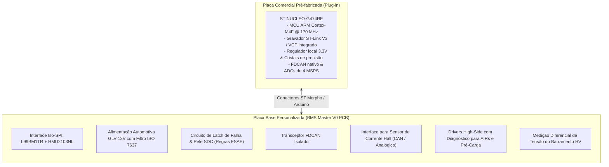
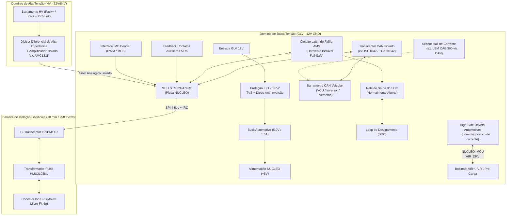
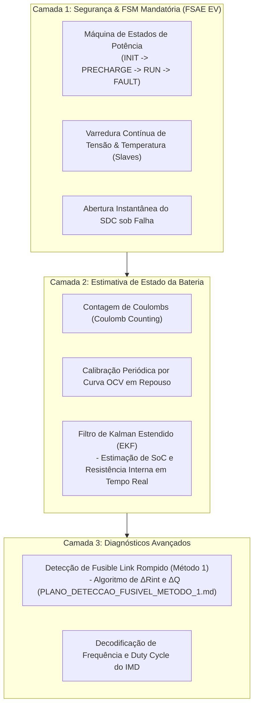

# 🏎️ Arquitetura de Sistema e Planejamento de Projeto — BMS Master V0
## ECU Central do Acumulador de Tração (20s18p) — Formula ITA (Formula SAE EV)

**Projeto:** `BMS Master - STM - V0`  
**Data de Emissão:** 22 de Outubro de 2026  
**Status do Documento:** 🟢 **Aprovado para Concepção de Hardware**  
**Classificação:** Especificação Técnica de Engenharia de Hardware & Firmware  

---

## 📑 Sumário

1. [Visão Geral & Contexto do Projeto](#1-visão-geral--contexto-do-projeto)
2. [Estratégia de Hardware: Carrier Shield para STM32 Nucleo](#2-estratégia-de-hardware-carrier-shield-para-stm32-nucleo)
3. [Topologia Geral do Acumulador & Interfaces](#3-topologia-geral-do-acumulador--interfaces)
4. [Diagrama de Blocos da Arquitetura](#4-diagrama-de-blocos-da-arquitetura)
5. [Detalhamento dos Subsistemas de Hardware](#5-detalhamento-dos-subsistemas-de-hardware)
   - [5.1. Interface Daisy-Chain Iso-SPI (L99BM1TR + HMU2103NL)](#51-interface-daisy-chain-iso-spi-l99bm1tr--hmu2103nl)
   - [5.2. Núcleo de Processamento (NUCLEO-G474RE)](#52-núcleo-de-processamento-nucleo-g474re)
   - [5.3. Alimentação Automotiva (GLV 12V $\to$ 5V)](#53-alimentação-automotiva-glv-12v-to-5v)
   - [5.4. Interface de Segurança SDC & Latch de AMS (FSAE EV)](#54-interface-de-segurança-sdc--latch-de-ams-fsae-ev)
   - [5.5. Sensoriamento de Corrente do Pack](#55-sensoriamento-de-corrente-do-pack)
   - [5.6. Sensoriamento de Alta Tensão & Pré-Carga](#56-sensoriamento-de-alta-tensão--pré-carga)
   - [5.7. Comunicação Veicular (CAN-FD Isolada)](#57-comunicação-veicular-can-fd-isolada)
   - [5.8. Controle dos Contatores (AIRs & Pré-Carga)](#58-controle-dos-contatores-airs--pré-carga)
6. [Integração de Firmware & Algoritmos Avançados](#6-integração-de-firmware--algoritmos-avançados)
7. [Roadmap de Execução & Próximos Passos](#7-roadmap-de-execução--próximos-passos)

---

## 1. Visão Geral & Contexto do Projeto

Após a conclusão e validação do módulo escravo descentralizado (**BMS Slave 5S** baseado no ASIC automotivo **STMicroelectronics L99BM114** e transformadores de isolação **Pulse HMU2103NL**), este documento estabelece as diretrizes de engenharia para o desenvolvimento da **ECU Mestre do Acumulador (BMS Master)**.

### Evolução em Relação aos Projetos Anteriores:
* **Descarte de Arquiteturas Inadequadas:** Projetos legados baseados em plataformas genéricas de prototipagem (como Arduino Nano, multiplexadores analógicos CD4051 e optoacopladores EL817) foram descontinuados devido à falta de imunidade a ruídos, desvios térmicos inaceitáveis ($\pm 15\%$), correntes de fuga que desbalanceiam o pack e não conformidade com o regulamento da Formula SAE EV.
* **Adoção do Ecossistema ST BMS:** O BMS Master utilizará o CI ponte dedicado **ST L99BM1TR** (*SPI-to-Isolated-SPI Transceiver*), garantindo compatibilidade nativa de protocolo de quadro, temporização diferencial e robustez de modo comum com a cadeia de escravos.

---

## 2. Estratégia de Hardware: Carrier Shield para STM32 Nucleo

Para conciliar **alta confiabilidade de corrida**, **baixo tempo de desenvolvimento** e **facilidade de manutenção no box**, o hardware do BMS Master V0 será concebido como uma **Placa Base (Carrier Board / Shield)** para acomodar uma placa comercial **ST NUCLEO-G474RE** (ou compatível com conectores Morpho / Arduino Uno).

### Vantagens Competitivas Desta Abordagem:
1. **Risco de Solda/Layout do MCU Reduzido a Zero:** O circuito complexo de desacoplamento, cristais externos, boot e depuração já vem pronto e testado pela ST.
2. **Substituição Instantânea em Paddock:** Em caso de queima acidental de porta de I/O por transitório durante testes, basta desconectar a placa Nucleo e plugar uma sobressalente em 60 segundos.
3. **Depuração Simplificada:** Um único cabo USB conectado ao notebook provê simultaneamente gravação de firmware, debug via SWD e telemetria por porta serial virtual (VCP).

---

## 3. Topologia Geral do Acumulador & Interfaces

* **Configuração Elétrica:** Topologia **20s18p** (20 células em série, 18 células em paralelo por bloco), baseada em células cilíndricas Li-Ion de $3{,}6\text{ V}$ nominal ($4{,}2\text{ V}$ máx).
* **Níveis de Tensão do Barramento:**
  * Tensão Mínima de Corte ($V_{min}$): $20 \times 2{,}8\text{ V} = 56{,}0\text{ V}$
  * Tensão Nominal ($V_{nom}$): $20 \times 3{,}6\text{ V} = 72{,}0\text{ V}$
  * Tensão Máxima de Carga ($V_{max}$): $20 \times 4{,}2\text{ V} = 84{,}0\text{ V}$
* **Segmentação em Slaves:** 4 módulos escravos de 5S cada ($4 \times 5\text{S} = 20\text{S}$).
* **Cadeia Daisy-Chain:**
  $$\text{Master (L99BM1TR)} \xrightarrow{\text{Iso-SPI}} \text{Slave 1} \xrightarrow{\text{Iso-SPI}} \text{Slave 2} \xrightarrow{\text{Iso-SPI}} \text{Slave 3} \xrightarrow{\text{Iso-SPI}} \text{Slave 4}$$

---

## 4. Diagrama de Blocos da Arquitetura

---

## 5. Detalhamento dos Subsistemas de Hardware

### 5.1. Interface Daisy-Chain Iso-SPI (L99BM1TR + HMU2103NL)
* **Função:** Estabelecer a ponte bidirecional entre o periférico SPI nativo do microcontrolador e o par diferencial isolado de pulsos dos escravos.
* **Componentes Centrais:**
  * CI transceptor `L99BM1TR` (encapsulamento SO-16N).
  * Transformador de isolação de pulsos `HMU2103NL` (fabricante Pulse Electronics, grau automotivo AEC-Q200, isolamento $\ge 2500\text{ V RMS}$).
* **Linhas de Controle MCU $\leftrightarrow$ L99BM1TR:**
  * `SPI_MOSI`, `SPI_MISO`, `SPI_SCK`, `SPI_NSS` (Chip Select dedicado).
  * `READY` / `FAULT_N` (pino de interrupção para alerta imediato de integridade da comunicação).
  * `EN` (habilitação e controle de economia de energia).
* **Conector Externo:** Molex Micro-Fit 3.0 de 4 pinos (mesmo padrão `J4/J5` validado no módulo escravo), garantindo padronização de chicote.

### 5.2. Núcleo de Processamento (NUCLEO-G474RE)
* **Características Principais:**
  * Núcleo ARM Cortex-M4F rodando a até $170\text{ MHz}$ com MPU e FPU.
  * 3x controladores **FDCAN** integrados com suporte a taxas de até $5\text{ Mbps}$.
  * 5x ADCs ultrarrápidos de 12 bits com até $4\text{ MSPS}$ por canal.
  * Aceleradores dedicados de hardware para trigonometria e filtragem matemática (**CORDIC** e **FMAC**), ideais para estimadores de estado.
* **Forma de Encaixe:**
  * Barra de conectores fêmea no Carrier Shield alinhada aos pinos Morpho/Arduino Uno da placa Nucleo.

### 5.3. Alimentação Automotiva (GLV 12V $\to$ 5V)
* **Faixa de Operação:** $8\text{ V}$ a $16\text{ V}$ DC (nominal $12\text{ V}$ do barramento GLV do protótipo).
* **Proteções de Entrada (ISO 7637-2 / ISO 16750-2):**
  * Diodo Schottky de potência ou circuito com MOSFET canal P para proteção contra inversão de polaridade.
  * Supressor de transientes de tensão (TVS) automotivo de $600\text{ W}$ a $1500\text{ W}$ (série SMBJ ou TPSMB) para grampeamento de picos indutivos.
  * Filtro passa-baixas LC em configuração $\pi$ para atenuação de ripple gerado por bombas, ventoinhas e atuadores de freio.
* **Conversor DC-DC:**
  * Regulador Step-Down síncrono automotivo (ex: TI `LMR36015` ou ST `A6986`), rebaixando $12\text{ V}$ para $5{,}0\text{ V}$ com rendimento $> 88\%$.
  * Os $5{,}0\text{ V}$ gerados alimentam a placa Nucleo através do pino `E5V` e os transceptores CAN/L99BM1TR.

### 5.4. Interface de Segurança SDC & Latch de AMS (FSAE EV)
* **Requisito Mandatório de Regulamento (EV4.8 / EV8):** Se o BMS detectar qualquer violação de tensão ($V_{cell} < 2{,}8\text{ V}$ ou $V_{cell} > 4{,}2\text{ V}$), temperatura ($T_{cell} > 60\ ^\circ\text{C}$) ou perda de comunicação com os escravos, o circuito de segurança (**Shutdown Circuit - SDC**) deve ser **aberto imediatamente**.
* **Comportamento Fail-Safe:** O circuito empregará relé ou chave de estado sólido com **contato normalmente aberto (NO)**. A perda de alimentação ou travamento do MCU resulta na desenergização imediata da bobina, abrindo o SDC.
* **Trava de Falha por Hardware (AMS Fault Latch):**
  * Uma vez disparada uma falha crítica, um circuito biestável (flip-flop ou circuito discreto baseado em SCR / transistorizado) memoriza o estado de falha, impedindo rearme espontâneo até que um pulso de reset manual de baixa tensão seja acionado deliberadamente pelo piloto/equipe no painel.

### 5.5. Sensoriamento de Corrente do Pack
* **Abordagem Primária (Recomendada):** Sensor de Efeito Hall automotivo de anel fechado com interface CAN nativa (ex: **LEM CAB 300 / 500** ou **Isabellenhütte IVT-S**).
  * *Vantagem:* Isolação galvânica física absoluta (o cabo de alta tensão passa livremente pelo núcleo magnético). Sinal digital pré-calibrado sem sobrecarregar a PCB com ruídos de modo comum.
* **Abordagem Secundária (Fallback Analógico):** Sensor Hall com saída de tensão ratiométrica (ex: **LEM DHAB S/133** ou série **HASS**).
  * A placa base disponibilizará conector analógico com divisor resistivo e filtro passa-baixas dedicado conectado a um canal de ADC da Nucleo.

### 5.6. Sensoriamento de Alta Tensão & Pré-Carga
* **Função:** Medir a tensão real do acumulador e a tensão presente no link DC do inversor para sincronizar a sequência de fechamento de contatores.
* **Circuito de Medição:**
  * Divisores resistivos de alta impedância balanceados ($> 1\text{ M}\Omega$).
  * Amplificador de isolação óptica/capacitiva de alta precisão (ex: TI `AMC1311` ou `AMC1300`), mantendo a integridade da separação entre alta tensão e o circuito digital do microcontrolador.

### 5.7. Comunicação Veicular (CAN-FD Isolada)
* **Transceptor:** CI dedicado de alta velocidade com isolação galvânica integrada (ex: TI `ISO1042` ou `TCAN1042` com isolador digital `ISO7721`).
* **Proteção de Linha:** Diodo TVS bidirecional automotivo nas linhas CAN_H e CAN_L, com resistor de terminação selecionável por jumper ($120\,\Omega$).
* **Protocolo:** Suporte configurável para **CAN 2.0B** clássico ($500\text{ kbps}$) ou **CAN-FD** ($2\text{ Mbps}$ a $5\text{ Mbps}$) para telemetria em tempo real e integração com a VCU.

### 5.8. Controle dos Contatores (AIRs & Pré-Carga)
* **Atuadores Controlados:**
  1. **AIR+** (Accumulator Isolation Relay Positivo)
  2. **AIR-** (Accumulator Isolation Relay Negativo)
  3. **Relé de Pré-Carga** (em série com resistor de potência)
* **Topologia de Acionamento:**
  * *High-Side Drivers* automotivos protegidos (série ST `VN70xx` ou TI `TPS2Hxx`), dotados de proteção contra curto-circuito, sobretemperatura, clamp indutivo integrado para desenergização de bobina e telemetria de corrente.
  * Entradas digitais dedicadas com optoacopladores para leitura dos **contatos auxiliares** dos contatores (garantindo verificação de contato soldado antes da liberação do veículo).

---

## 6. Integração de Firmware & Algoritmos Avançados

O hardware foi projetado para acomodar três camadas de software no STM32G474RE:

---

## 7. Roadmap de Execução & Próximos Passos

| Etapa | Atividade / Entregável | Status |
| :---: | :--- | :---: |
| **01** | Definição da arquitetura e estratégia Carrier Shield (STM32 Nucleo) | 🟢 **Concluído** |
| **02** | Confirmação dos modelos de conectores externos e dimensões mecânicas | 🟡 **Aguardando Alinhamento** |
| **03** | Criação do projeto KiCad 10 do BMS Master (`BMS_Master_v0.kicad_pro`) | ⚪ A Iniciar |
| **04** | Captura do Esquemático Hierárquico (L99BM1TR, Buck 12V, CAN, SDC, Nucleo Headers) | ⚪ A Iniciar |
| **05** | Revisão de ERC, Footprints e Regras de Creepage/Clearance ($\ge 4\text{ mm}$ HV/LV) | ⚪ A Iniciar |
| **06** | Roteamento do Layout 4-camadas e Geração de Arquivos de Fabricação (Gerber/BOM) | ⚪ A Iniciar |

---
*Documento homologado para orientar as decisões de engenharia do protótipo Formula ITA 2025-2026.*
