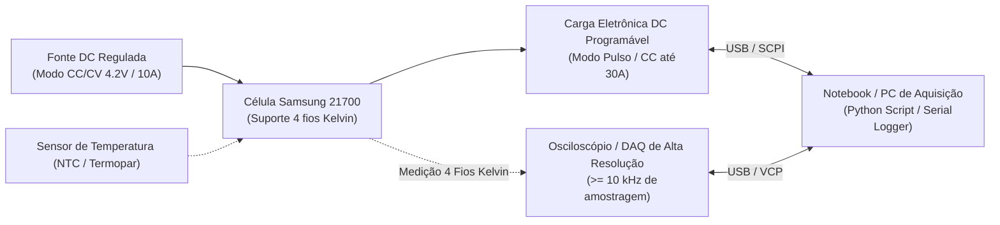
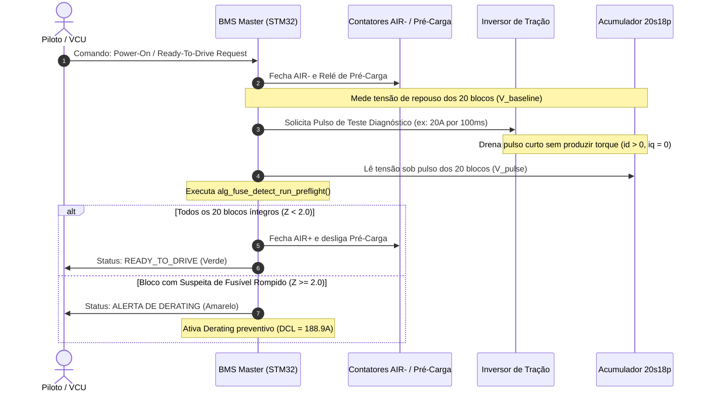

# 🔬 Guia Prático de Engenharia: Ensaio de Caracterização e Identificação de Parâmetros
## Células Samsung INR21700 (40T / 30T) — Formula ITA (Formula SAE Electric)

**Documento:** `GUIA_ENSAIO_CARACTERIZACAO_CELULAS_21700.md`  
**Público-Alvo:** Membros das áreas de Powertrain, Baterias (Acumulador) e Eletrônica/Firmware  
**Objetivo:** Padronizar a bancada de testes para extrair os parâmetros eletroquímicos Thévenin ($R_0$, $R_p$, $C_p$) e a curva $OCV(SOC)$ das células Samsung 21700, estabelecendo os limites de aceitação (*cell screening/matching*) e calibrando o algoritmo de detecção de fusíveis do BMS Master.

---

## 1. Por que esse ensaio é vital para o nosso carro?

Na topologia do nosso acumulador (**20s18p**, 360 células):
* Cada bloco possui **18 células em paralelo**.
* A célula **Samsung INR21700** é uma célula de altíssima potência, com resistência interna ($DC\text{-}IR$) em torno de apenas **$15{,}0\text{ m}\Omega$** a 25 °C.
* Em paralelo, a resistência equivalente de um bloco íntegro é de apenas:
  $$R_{0,\text{bloco}} = \frac{15{,}0\text{ m}\Omega}{18} \approx \mathbf{0{,}833\text{ m}\Omega}\quad (833\ \mu\Omega)$$
* Se um fusível romper, restam 17 células ativas:
  $$R'_{0,\text{bloco}} = \frac{15{,}0\text{ m}\Omega}{17} \approx \mathbf{0{,}882\text{ m}\Omega}\quad (882\ \mu\Omega)$$
* A variação provocada pelo rompimento é de apenas **$+49\ \mu\Omega$** (+5,88%).
* Em uma frenagem (onde **não temos freio regenerativo**) ou em correntes moderadas ($40\text{ A}$), essa variação gera uma diferença de tensão de apenas:
  $$\Delta V = 40\text{ A} \times 49\ \mu\Omega \approx \mathbf{1{,}96\text{ mV}}$$

> [!IMPORTANT]
> Um sinal de $1{,}96\text{ mV}$ está muito próximo do ruído de medição do CI de monitoramento ($\approx \pm 1{,}5\text{ mV}$). Para o BMS Master identificar essa queima de forma confiável e sem falsos positivos, **precisamos conhecer com precisão de bancada a dispersão inicial de resistência e capacidade de cada bloco montado**.

---

## 2. Equipamentos e Instrumentação Necessários

Para montar a bancada no laboratório da Formula ITA, precisaremos de:



1. **Suporte de Célula com Conexão Kelvin de 4 Fios:**  
   * **Fundamental:** Nunca use suportes de mola comuns para medir resistência em miliohms! A resistência de contato de uma mola convencional varia de $10\text{ m}\Omega$ a $50\text{ m}\Omega$, o que destruirá a medição.
   * Utilize garras Kelvin ou barramentos aparafusados com pontas de prova de tensão separadas das de corrente.
2. **Carga Eletrônica DC Programável:**  
   * Capacidade de dreno contínuo de pelo menos $30\text{ A}$ e suporte a transitórios rápidos ($t_{rise} < 1\text{ ms}$).
3. **Fonte de Alimentação DC Regulada:**  
   * $0\text{ a }5\text{ V}$, $0\text{ a }10\text{ A}$ com modo $CC/CV$.
4. **Sistema de Aquisição de Dados (DAQ) ou Osciloscópio:**  
   * Resolução $\ge 12\text{ bits}$ e amostragem $\ge 1\text{ kHz}$ para capturar a transição inicial em microsegundos.
5. **Sensor de Temperatura:**  
   * NTC $10\text{ k}\Omega$ ou termopar tipo K fixado com fita Kapton na lateral da célula (a resistência interna varia significativamente com a temperatura: $-0{,}3\text{ m}\Omega / ^\circ\text{C}$).

---

## 3. Protocolo de Ensaio: Pulso HPPC (Hybrid Pulse Power Characterization)

O ensaio HPPC (baseado nas normas FreedomCAR / USABC) é o padrão internacional para separar a resistência ôhmica pura ($R_0$) da dinâmica de transferência de carga e difusão ($R_p \parallel C_p$).

### 3.1. Forma de Onda do Perfil de Teste

```text
Corrente [A]
  30A |          +----------------+  (Pulso de Descarga: 10 segundos @ 30A)
      |          |                |
   0A +----------+                +------------------------- (Relaxação: 40 segundos)
      |
 -10A |                                                      (Sem regen / opcional carga)
      +----------------------------------------------------> Tempo [s]
```

### 3.2. Curva de Tensão Terminal e Extração dos Parâmetros

```text
Tensão Terminal V(t)
 V_ocv +------------\
       |             \ (Queda Ôhmica Instantânea: ΔV_0 em t < 10 ms)
       |              +---------------------------\
       |                                           \ (Decaimento Exponencial V_p: tau = Rp * Cp)
       |                                            +------------+ (Fim do pulso de 10s)
       |                                                         |
       |                                                         | (Salto Ôhmico de Subida: ΔV_0)
       |                                                         \---------\
       |                                                                    +--- (Relaxação)
       +------------------------------------------------------------------------> Tempo [s]
       t0            t1                                          t2              t3
```

### 3.3. Equações Matemáticas para Cálculo

1. **Resistência Ôhmica Pura ($R_0$):**  
   Mede a queda puramente resistiva nos primeiros $10\text{ ms}$ após o degrau de corrente de $I_{pulso} = 30\text{ A}$:
   $$R_0 = \frac{V(t_0) - V(t_1)}{I_{pulso}}$$
   *Para a Samsung INR21700-40T saudável, o valor esperado a 25 °C é entre **$12{,}5\text{ m}\Omega$ e $15{,}5\text{ m}\Omega$**.*

2. **Resistência de Polarização ($R_p$):**  
   Mede a queda adicional provocada pela resistência de transferência de carga e difusão eletroquímica ao longo dos $10\text{ segundos}$:
   $$R_p = \frac{V(t_1) - V(t_2)}{I_{pulso}} - \frac{\Delta V_{soc}}{I_{pulso}}$$

3. **Capacitância Equivalente ($C_p$):**  
   Ajusta-se a constante de tempo $\tau$ da curva exponencial:
   $$V_p(t) = I_{pulso} \cdot R_p \cdot \left(1 - e^{-t/\tau}\right) \implies \tau = R_p \cdot C_p \implies C_p = \frac{\tau}{R_p}$$
   *Valores típicos para a Samsung 21700: $\tau \approx 1{,}5\text{ a }3{,}0\text{ segundos}$ e $C_p \approx 2000\text{ a }3000\text{ F}$.*

---

## 4. Ensaio de Levantamento da Curva OCV vs SOC

1. Carregar a célula até $4{,}20\text{ V}$ em modo $CC/CV$ até que a corrente caia para $C/50$ ($80\text{ mA}$).
2. Deixar a célula em repouso térmico e elétrico por **2 horas** (essencial para estabilização da dupla camada).
3. Registrar a tensão de circuito aberto $OCV(100\%)$.
4. Drenar $10\%$ da capacidade nominal da célula em corrente lenta de $C/5$ ($0{,}8\text{ A}$ por 30 minutos).
5. Aguardar **1 hora de repouso** e registrar $OCV(90\%)$.
6. Repetir o processo em degraus de $10\%$ até atingir $2{,}80\text{ V}$ ($SOC = 0\%$).

### Tabela de Referência Típica: Samsung INR21700

| SOC [%] | OCV Típica [V] | $R_0$ Médio @ 25°C [mΩ] |
| :---: | :---: | :---: |
| **100%** | $4{,}200\text{ V}$ | $14{,}2\text{ m}\Omega$ |
| **90%** | $4{,}085\text{ V}$ | $14{,}4\text{ m}\Omega$ |
| **80%** | $3{,}980\text{ V}$ | $14{,}6\text{ m}\Omega$ |
| **70%** | $3{,}890\text{ V}$ | $14{,}8\text{ m}\Omega$ |
| **60%** | $3{,}805\text{ V}$ | $15{,}0\text{ m}\Omega$ |
| **50%** | $3{,}730\text{ V}$ | $15{,}1\text{ m}\Omega$ |
| **40%** | $3{,}675\text{ V}$ | $15{,}3\text{ m}\Omega$ |
| **30%** | $3{,}620\text{ V}$ | $15{,}8\text{ m}\Omega$ |
| **20%** | $3{,}540\text{ V}$ | $16{,}5\text{ m}\Omega$ |
| **10%** | $3{,}380\text{ V}$ | $18{,}2\text{ m}\Omega$ |
| **0%** | $2{,}800\text{ V}$ | $24{,}0\text{ m}\Omega$ |

---

## 5. Critérios de Seleção e Casamento de Células (*Cell Screening & Matching*)

Ao receber o lote de 360 células Samsung 21700 para a montagem do acumulador de tração:
1. **Medição de Impedância AC a 1 kHz:** Usar um mili-ohmímetro AC portátil (ex: YR1035+) em todas as 360 células.
2. **Critério de Descarte (Outliers):**
   * Qualquer célula com $R_{0} > 1{,}15 \times R_{0,\text{med}}$ ou com tensão de entrega desbalanceada em mais de $20\text{ mV}$ deve ser separada e descartada para o pack de tração.
3. **Distribuição Equitativa nos 20 Blocos (18p cada):**
   * Ordenar as células por resistência e distribuí-las de modo que a soma das condutâncias $\sum \frac{1}{R_{cell}}$ de cada um dos 20 blocos seja idêntica com dispersão menor que **$\pm 0{,}5\%$**.
   * Isso garante que a linha de base dos 20 blocos seja extremamente homogênea, facilitando a identificação imediata de qualquer anomalia pelo BMS Master.

---

## 6. Algoritmo de Identificação no BMS Antes de Ligar o Carro (Pre-Flight Health Check)

Para não depender apenas da corrida na pista, implementamos no firmware do BMS Master a função de **Auto-Teste de Impedância Pré-Partida**:



### Vantagens Desta Abordagem:
1. **Elimina o tempo de convergência na largada:** O BMS Master já inicia a corrida sabendo exatamente qual é a resistência $R_0$ de cada bloco.
2. **Segurança total no Box:** Se um fusível queimar durante o transporte ou recarga na tenda, a equipe descobre no segundo em que liga o carro, antes mesmo de entrar na pista.

---

*Documento homologado para a equipe Formula ITA — Temporada 2025-2026.*
