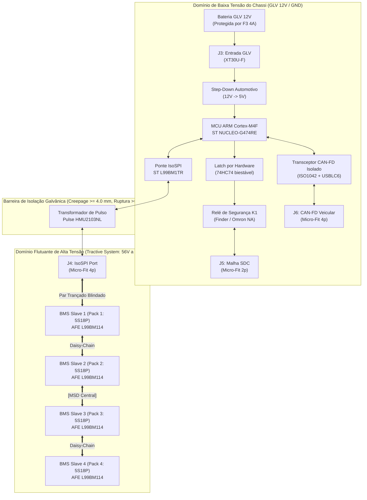
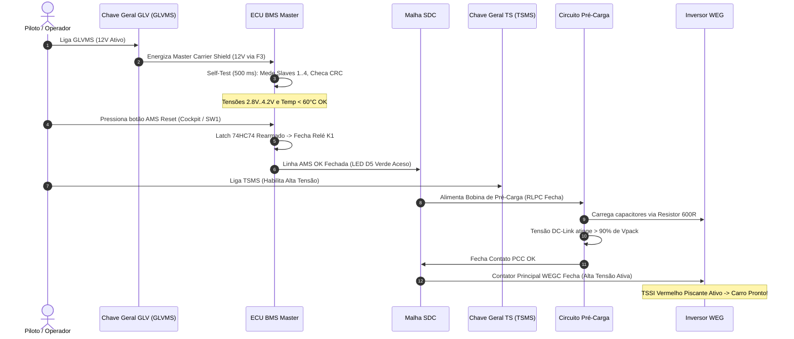

# 🏁 Manual de Montagem, Operação e Procedimentos de Segurança (SOP)
## Sistema de Gerenciamento de Baterias (BMS Master V0 + BMS 5S Slave V2)
### Acumulador de Tração 20S18P — Formula ITA (Formula SAE Electric)

**Documento:** `SOP-BMS-ITA-2026-V1`  
**Data de Emissão:** 24 de Outubro de 2026  
**Status:** 🟢 **Documento Oficial Homologado de Engenharia e Operação de Pista**  
**Classificação:** Procedimento Operacional Padrão (SOP), Manual de Montagem e Guia de Diagnóstico  

---

## 📑 Sumário Executivo

1. [Visão Geral e Arquitetura do Sistema](#1-visão-geral-e-arquitetura-do-sistema)
2. [Mapeamento Completo de Conectores, Pinouts e Chicotes](#2-mapeamento-completo-de-conectores-pinouts-e-chicotes)
   - 2.1. [BMS Master Carrier Shield V0 (Pinout & Funções)](#21-bms-master-carrier-shield-v0-pinout--funções)
   - 2.2. [BMS 5S Slave V2 (Pinout & Funções)](#22-bms-5s-slave-v2-pinout--funções)
   - 2.3. [Diagrama de Interconexão em Daisy-Chain IsoSPI](#23-diagrama-de-interconexão-em-daisy-chain-isospi)
3. [Manual de Montagem e Testes em Bancada (Bench Testing SOP)](#3-manual-de-montagem-e-testes-em-bancada-bench-testing-sop)
   - 3.1. [EPIs Mandatórios e Requisitos Antiestáticos (ESD)](#31-epis-mandatórios-e-requisitos-antiestáticos-esd)
   - 3.2. [Acoplamento Mecânico Master Shield + NUCLEO-G474RE](#32-acoplamento-mecânico-master-shield--nucleo-g474re)
   - 3.3. [Regra de Ouro: Sequência Estrita de Ligação das Células](#33-regra-de-ouro-sequência-estrita-de-ligação-das-células)
   - 3.4. [Procedimento Seguro de Energização de Baixa Tensão (Power-Up)](#34-procedimento-seguro-de-energização-de-baixa-tensão-power-up)
   - 3.5. [Procedimento de Teste de Rearme e Disparo do SDC Latch](#35-procedimento-de-teste-de-rearme-e-disparo-do-sdc-latch)
   - 3.6. [Procedimento Seguro de Desenergização de Bancada](#36-procedimento-seguro-de-desenergização-de-bancada)
4. [Manual de Montagem e Integração no Veículo / Acumulador](#4-manual-de-montagem-e-integração-no-veículo--acumulador)
   - 4.1. [Arquitetura Física do Container do Acumulador (ACC)](#41-arquitetura-física-do-container-do-acumulador-acc)
   - 4.2. [Instalação e Fixação das Placas Escravas (Slaves 1 a 4)](#42-instalação-e-fixação-das-placas-escravas-slaves-1-a-4)
   - 4.3. [Posicionamento do MSD e Seccionamento de Baixa Tensão](#43-posicionamento-do-msd-e-seccionamento-de-baixa-tensão)
   - 4.4. [Roteamento do Chicote IsoSPI e Blindagem de Ruído (EMI)](#44-roteamento-do-chicote-isospi-e-blindagem-de-ruído-emi)
   - 4.5. [Integração com a Malha de Desligamento de Emergência (SDC)](#45-integração-com-a-malha-de-desligamento-de-emergência-sdc)
   - 4.6. [Integração com o Barramento CAN Veicular e Telemetria](#46-integração-com-o-barramento-can-veicular-e-telemetria)
5. [Procedimento Operacional Padrão (SOP de Pista e Box)](#5-procedimento-operacional-padrão-sop-de-pista-e-box)
   - 5.1. [Sequência de Partida e Habilitação em Pista (Pre-Drive Routine)](#51-sequência-de-partida-e-habilitação-em-pista-pre-drive-routine)
   - 5.2. [Procedimento de Recarga Segura no Box (Charging Cart SOP)](#52-procedimento-de-recarga-segura-no-box-charging-cart-sop)
6. [Matriz de Diagnóstico, Falhas e Ações Corretivas (Troubleshooting)](#6-matriz-de-diagnóstico-falhas-e-ações-corretivas-troubleshooting)
7. [Checklist Mandatório Pré-Corrida (Scrutineering Pre-Flight)](#7-checklist-mandatório-pré-corrida-scrutineering-pre-flight)

---

## 1. Visão Geral e Arquitetura do Sistema

O sistema de gerenciamento de baterias do protótipo Formula ITA é distribuído em duas categorias de hardware, operando sob barreira galvânica magnética:



### Especificações Globais do Acumulador:
* **Topologia:** $20\text{S}18\text{P}$ ($4$ módulos de $5\text{S}18\text{P}$ em série).
* **Química:** Íons de Lítio (Li-Ion 21700 / 18650).
* **Tensão Nominal do Pack:** $20 \times 3{,}60\text{ V} = \mathbf{72{,}0\text{ Vcc}}$.
* **Tensão Máxima de Recarga ($V_{max}$):** $20 \times 4{,}20\text{ V} = \mathbf{84{,}0\text{ Vcc}}$.
* **Tensão Mínima de Descarga ($V_{min}$):** $20 \times 2{,}80\text{ V} = \mathbf{56{,}0\text{ Vcc}}$.
* **Corrente Contínua / Pico:** $60\text{ A}$ a $90\text{ A}$ contínuos / $160\text{ A}$ a $200\text{ A}$ pico.
* **Corrente de Recarga em Box:** $10\text{ A}$ a $15\text{ A}$ ($CC/CV$).

---

## 2. Mapeamento Completo de Conectores, Pinouts e Chicotes

### 2.1. BMS Master Carrier Shield V0 (Pinout & Funções)

A placa Master Carrier Shield possui 4 conectores de interface externa perfeitamente identificados na serigrafia e travamento mecânico por trava positiva:

| Conector | Tipo de Conector / Footprint | Pino | Net / Sinal | Nível Elétrico | Descrição Funcional e Cuidados |
| :---: | :---: | :---: | :---: | :---: | :--- |
| **`J3`** | **AMASS XT30U-F** (Vertical Macho na Placa) | **1** | `GND` | $0\text{ V}$ (GLV) | Referência de terra da bateria de baixa tensão (chassi). |
| | | **2** | `+12V` | $+8\text{V}$ a $+16\text{V}$ | Entrada de alimentação GLV vinda da chave geral via fusível `F3 (4A)`. |
| **`J4`** | **Molex Micro-Fit 3.0** (1x04 Horizontal Trava) | **1** | `NC / SHIELD` | — | Pino sem conexão elétrica interna (opcional para malha/blindagem). |
| | | **2** | `ISOSPI_P` | $\pm 1{,}5\text{V}$ diff | Linha diferencial positiva de comunicação IsoSPI (secundário do trafo `T1`). |
| | | **3** | `ISOSPI_M` | $\pm 1{,}5\text{V}$ diff | Linha diferencial negativa de comunicação IsoSPI (secundário do trafo `T1`). |
| | | **4** | `NC / SHIELD` | — | Pino sem conexão elétrica interna (respeitar keepout de 4 mm). |
| **`J5`** | **Molex Micro-Fit 3.0** (1x02 Horizontal Trava) | **1** | `SDC_IN` | $+12\text{V}$ (Loop) | Entrada do laço do Shutdown Circuit (terminal do contato NA de `K1`). |
| | | **2** | `SDC_OUT` | $+12\text{V}$ (Loop) | Saída do laço do Shutdown Circuit (retorno para bobinas/próximos nós). |
| **`J6`** | **Molex Micro-Fit 3.0** (1x04 Horizontal Trava) | **1** | `CAN_H` | Linha CAN | Linha diferencial alta do barramento CAN-FD veicular (protegida por `USBLC6`). |
| | | **2** | `CAN_L` | Linha CAN | Linha diferencial baixa do barramento CAN-FD veicular (protegida por `USBLC6`). |
| | | **3** | `CAN_GND` | $0\text{ V}$ (Iso) | Terra flutuante do barramento CAN isolado galvanicamente pelo `B0505S`. |
| | | **4** | `NC / +5V_EXT` | $+5\text{V}$ (Opt) | Opcional para alimentação remota de nós do barramento (não conectado por padrão). |

> [!NOTE]
> **Jumper de Terminação CAN (`JP1`):**  
> O jumper `JP1` (ao lado de `J6`) conecta um resistor de terminação de $120\,\Omega$ ao barramento CAN. Feche o jumper com uma gota de solda ou jumper móvel **somente se o BMS Master for uma das extremidades físicas da rede CAN veicular**.

#### Mapeamento de LEDs e Controles de Bancada no Master:
* **LED `D3` (Verde):** Presença de alimentação `+12V` de entrada GLV.
* **LED `D4` (Verde):** Presença de alimentação `+5V` gerada pelo conversor buck.
* **LED `D5` (Verde - "SDC OK"):** Indica que o sistema está em estado seguro, o latch está habilitado e a bobina do relé `K1` está energizada (contatos fechados, SDC contínuo).
* **LED `D6` (Vermelho - "AMS FAULT"):** Indica falha crítica latched no AMS. O relé `K1` está desenergizado e o SDC está cortado.
* **Botão `SW1` (Pushbutton):** Botão físico de **Rearme Manual (Manual Reset)** do Flip-Flop biestável `74HC74`.

---

### 2.2. BMS 5S Slave V2 (Pinout & Funções)

Cada placa escrava monitora exatamente 5 células em série e 4 a 7 termistores NTC de temperatura:

| Conector | Pino | Net / Sinal | Nível Elétrico | Conexão Física no Sub-Pack |
| :---: | :---: | :---: | :---: | :--- |
| **`J3`**<br>(Molex Micro-Fit 3.0<br>2x08 Horizontal) | **1** | `BATT 14` | $+18{,}5\text{V}$ nom ($21\text{V}$ max) | Polo Positivo da Célula 5 ($B5+$ / Topo do Sub-Pack). |
| | **2** | `BATT 13` | $+14{,}8\text{V}$ nom | Tap entre Célula 4 e Célula 5 ($B4+$). |
| | **3** | `BATT 12` | $+11{,}1\text{V}$ nom | Tap entre Célula 3 e Célula 4 ($B3+$). |
| | **4** | `BATT 2` | $+7{,}4\text{V}$ nom | Tap entre Célula 2 e Célula 3 ($B2+$). |
| | **5** | `BATT 1` | $+3{,}7\text{V}$ nom | Tap entre Célula 1 e Célula 2 ($B1+$). |
| | **6** | `GND_ESD` | Chassis / Shield | Terminal de aterramento do invólucro do sub-pack para descarte de ESD. |
| | **7** | `ISENSEM_conn` | Shunt (-) | Kelvin negativo do resistor shunt local (se instalado). |
| | **8** | `ISENSEP_conn` | Shunt (+) | Kelvin positivo do resistor shunt local (se instalado). |
| | **9** | `NTC7+` | Sinal NTC Aux | Sensor de temperatura auxiliar / ar ambiente do pack. |
| | **10**| `NTC6+` | Sinal NTC Aux | Sensor de temperatura auxiliar da barra coletora (busbar). |
| | **11**| `NTC1+` | Sinal NTC Célula 1 | Termistor colado no corpo cilíndrico da Célula 1. |
| | **12**| `NTC2+` | Sinal NTC Célula 2 | Termistor colado no corpo cilíndrico da Célula 2. |
| | **13**| `NTC3+` | Sinal NTC Célula 3 | Termistor colado no corpo cilíndrico da Célula 3. |
| | **14**| `NTC4+` | Sinal NTC Célula 4 | Termistor colado no corpo cilíndrico da Célula 4. |
| | **15**| `NTC5+` | Sinal NTC Célula 5 | Termistor colado no corpo cilíndrico da Célula 5. |
| | **16**| `AGND` | $0\text{ V}$ Ref Sub-Pack | Polo Negativo da Célula 1 ($B0-$ / Fundo do Sub-Pack). |
| **`J4`**<br>(Micro-Fit 2x02) | **1, 2**| `GND_EXT` | Malha de blindagem | Blindagem de cabo do barramento IsoSPI inferior (porta de entrada). |
| | **3** | `ISOLM_c` | $\pm 1{,}5\text{V}$ diff | Linha diferencial negativa IsoSPI (de Master ou Slave anterior). |
| | **4** | `ISOLP_c` | $\pm 1{,}5\text{V}$ diff | Linha diferencial positiva IsoSPI (de Master ou Slave anterior). |
| **`J5`**<br>(Micro-Fit 2x02) | **1, 2**| `GND_EXT` | Malha de blindagem | Blindagem de cabo do barramento IsoSPI superior (porta de saída). |
| | **3** | `ISOHM_c` | $\pm 1{,}5\text{V}$ diff | Linha diferencial negativa IsoSPI (para o próximo Slave). |
| | **4** | `ISOHP_c` | $\pm 1{,}5\text{V}$ diff | Linha diferencial positiva IsoSPI (para o próximo Slave). |

#### Mapeamento de LEDs no Slave:
* **LED `D4` (Verde - "3.2V"):** Indica que o circuito regulador linear interno `VREG` do CI `L99BM114` está ativo, alimentando os blocos analógicos e a máquina de estados interna do AFE.

---

### 2.3. Diagrama de Interconexão em Daisy-Chain IsoSPI

A comunicação de dados entre a Master e os 4 Slaves é realizada através de um barramento serial diferencial de pulso isolado (IsoSPI), encadeado em cascata:

```
[BMS Master Carrier Shield]
  Conector J4 (Molex 1x04)
     Pino 2 (ISOSPI_P)  ------------------------+
     Pino 3 (ISOSPI_M)  ------------------+     |  (Par Trançado Blindado)
                                          |     |
                                          v     v
                               [BMS Slave 1 (Sub-Pack 1)]
                                 Conector J4 (Porta LOW)
                                   Pino 4 (ISOLP_c)
                                   Pino 3 (ISOLM_c)
                                 Conector J5 (Porta HIGH)
                                   Pino 4 (ISOHP_c)  -----+
                                   Pino 3 (ISOHM_c)  --+  |
                                                       |  |
                                                       v  v
                                            [BMS Slave 2 (Sub-Pack 2)]
                                              Conector J4 (Porta LOW)
                                                Pino 4 (ISOLP_c)
                                                Pino 3 (ISOLM_c)
                                              Conector J5 (Porta HIGH)
                                                Pino 4 (ISOHP_c)  -----+
                                                Pino 3 (ISOHM_c)  --+  |
                                                                    |  |  (Cruza barreira do MSD)
                                                                    v  v
                                                         [BMS Slave 3 (Sub-Pack 3)]
                                                           Conector J4 (Porta LOW)
                                                             Pino 4 (ISOLP_c)
                                                             Pino 3 (ISOLM_c)
                                                           Conector J5 (Porta HIGH)
                                                             Pino 4 (ISOHP_c)  -----+
                                                             Pino 3 (ISOHM_c)  --+  |
                                                                                 |  |
                                                                                 v  v
                                                                      [BMS Slave 4 (Sub-Pack 4)]
                                                                        Conector J4 (Porta LOW)
                                                                          Pino 4 (ISOLP_c)
                                                                          Pino 3 (ISOLM_c)
                                                                        Conector J5: NÃO CONECTADO
                                                                        (Terminado por HW no Slave)
```

---

## 3. Manual de Montagem e Testes em Bancada (Bench Testing SOP)

### 3.1. EPIs Mandatórios e Requisitos Antiestáticos (ESD)
1. **Luvas de Proteção:** Luvas de isolamento elétrico classe 00 (500V) para manipulação de células ou chicotes com tensão agregada $> 30\text{ V}$.
2. **Óculos de Segurança:** Obrigatório durante qualquer soldagem, conexão ou teste sob tensão.
3. **Manta e Pulseira Antiestática:** A bancada deve possuir manta dissipativa com resistor de aterramento de $1\text{ M}\Omega$. O operador deve utilizar pulseira antiestática ao tocar nas placas desenergizadas.
4. **Ferramental Isolado:** Chaves de fenda e alicates com cabo isolado para $1000\text{ V}$ (norma IEC 60900).

---

### 3.2. Acoplamento Mecânico Master Shield + NUCLEO-G474RE
1. Inspecione visualmente se os pinos dos conectores Morpho fêmea `J1` e `J2` no verso da Master Shield estão perfeitamente alinhados e sem resíduos de solda.
2. Posicione a placa **NUCLEO-G474RE** sobre uma superfície rígida e isolante.
3. Instale **4 espaçadores hexagonais de nylon M3 (comprimento 11 mm)** nos furos de canto da Nucleo.
4. Alinhe cuidadosamente os conectores Morpho da Shield com as barras macho da Nucleo.
5. Pressione de forma suave e homogênea nas extremidades da placa até que o conector assente completamente contra a base.
6. Fixe os 4 parafusos de nylon M3 superiores. **Nunca use parafusos metálicos**, pois eles violam o isolamento das trilhas adjacentes.

---

### 3.3. Regra de Ouro: Sequência Estrita de Ligação das Células

> [!CAUTION]
> **RISCO DE DESTRUIÇÃO DO CIRCUITO INTEGRADO AFE (L99BM114):**  
> Os circuitos integrados de medição de células possuem diodos internos de proteção ESD e transistores de balanceamento com limite de tensão reversa de substrato. Se o polo positivo ($B5+$) for conectado antes do terra analógico ($AGND$), a corrente de carga de capacitores internos fluirá através dos diodos de proteção de substrato, destruindo permanentemente os canais de ADC do chip!

#### Procedimento Mandatório para Conexão de Bancada:
1. **Opção A (Recomendada - Conector Completo Pré-Montado):**
   - Monte o chicote de teste de 5 células com o conector Molex Micro-Fit `J3` **completamente desacoplado da placa**.
   - Conecte as 5 derivações de célula aos bornes ou bateria de teste.
   - Meça com multímetro nos terminais fêmea do conector:
     - Pino 16 ($AGND$) para Pino 5 ($B1$): deve medir $+3{,}0\text{V}$ a $+4{,}2\text{V}$.
     - Pino 16 ($AGND$) para Pino 4 ($B2$): deve medir $+6{,}0\text{V}$ a $+8{,}4\text{V}$.
     - Pino 16 ($AGND$) para Pino 3 ($B3$): deve medir $+9{,}0\text{V}$ a $+12{,}6\text{V}$.
     - Pino 16 ($AGND$) para Pino 2 ($B4$): deve medir $+12{,}0\text{V}$ a $+16{,}8\text{V}$.
     - Pino 16 ($AGND$) para Pino 1 ($B5$): deve medir $+15{,}0\text{V}$ a $+21{,}0\text{V}$.
   - Estando as tensões e polaridades 100% corretas, insira o conector `J3` na placa **em um único movimento firme e retilíneo**, travando o trinco plástico.

2. **Opção B (Conexão Fio a Fio com Garras de Prova):**
   - Conecte estritamente na seguinte ordem cronológica:
     1. `Pino 16 (AGND / B0-)`
     2. `Pino 5 (BATT 1)`
     3. `Pino 4 (BATT 2)`
     4. `Pino 3 (BATT 12)`
     5. `Pino 2 (BATT 13)`
     6. `Pino 1 (BATT 14 / B5+)`
     7. Pinos dos termistores NTC (Pinos 11 a 15).

---

### 3.4. Procedimento Seguro de Energização de Baixa Tensão (Power-Up)
1. Conecte a fonte de bancada ajustada para **$+12{,}0\text{ Vcc}$ com limite de corrente em $300\text{ mA}$** ao conector `J3` da Master Shield (Pino 1 = GND, Pino 2 = +12V).
2. Ligue a fonte e observe a corrente consumida:
   - **Corrente Normal:** Entre $80\text{ mA}$ e $140\text{ mA}$ (com LEDs acesos e Nucleo rodando).
   - Se a corrente atingir o limite de $300\text{ mA}$ e a tensão cair, **desligue imediatamente** (indício de curto-circuito ou inversão de montagem).
3. Verifique os LEDs de alimentação:
   - LED `D3` (12V) aceso em verde brilhante.
   - LED `D4` (5V) aceso em verde brilhante.
   - LEDs da placa Nucleo (`LD3` / PWR) acesos.
4. Conecte o cabo do barramento IsoSPI entre a Master (`J4`) e o Slave 1 (`J4`).
5. Observe a placa Slave 1: o LED verde `D4` (3.2V) deve acender, indicando que o CI L99BM114 acordou via pulso IsoSPI e gerou sua alimentação interna de regulação.

---

### 3.5. Procedimento de Teste de Rearme e Disparo do SDC Latch
1. **Estado Inicial pós-boot:**
   - O LED vermelho `D6` ("AMS FAULT") estará aceso.
   - O LED verde `D5` ("SDC OK") estará apagado.
   - O relé `K1` estará desenergizado (contatos abertos entre os pinos 1 e 2 de `J5`). Verifique com multímetro em modo continuidade: deve acusar **circuito aberto ($\infty\,\Omega$)**.
2. **Rearme Manual (Reset):**
   - Verifique no console serial USB (115200 bps) se todas as células lidas estão entre $2{,}80\text{V}$ e $4{,}20\text{V}$ e temperaturas $< 60\,^\circ\text{C}$.
   - Pressione momentaneamente o botão **`SW1`** na Master Shield.
   - **Resposta Imediata:**
     - LED vermelho `D6` apaga.
     - LED verde `D5` ("SDC OK") acende.
     - O relé `K1` emite um estalo audível de fechamento.
     - O multímetro em `J5` aponta continuidade franca ($< 0{,}2\,\Omega$).
3. **Teste de Disparo por Falha (Injeção de Erro):**
   - Desconecte uma das conexões de célula ou simule uma subtensão via comando serial de bancada.
   - **Resposta Imediata ($< 500\text{ ms}$):**
     - O MCU envia um pulso em `PB0_AMS_FAULT_SET`.
     - O Flip-Flop `U4` comuta instantaneamente em hardware.
     - LED verde `D5` apaga e LED vermelho `D6` acende.
     - O relé `K1` abre instantaneamente a linha do SDC.
     - Pressionar `SW1` enquanto a falha persistir **NÃO deve rearmar o relé**, comprovando a integridade do circuito de segurança.

---

### 3.6. Procedimento Seguro de Desenergização de Bancada
1. Desligue a fonte de alimentação de baixa tensão `+12V` em `J3`.
2. Desconecte o cabo USB do computador.
3. Desconecte o cabo do barramento IsoSPI (`J4`).
4. **Desconexão das Células:**
   - Desconecte o plugue `J3` da Slave Board por completo.
   - Caso esteja usando conexões manuais, desconecte na **ordem estritamente decrescente**: $B5+ \to B4 \to B3 \to B2 \to B1 \to AGND$.

---

## 4. Manual de Montagem e Integração no Veículo / Acumulador

### 4.1. Arquitetura Física do Container do Acumulador (ACC)
Conforme estabelecido no documento de arquitetura veicular e nas normas FSAE EV:
1. O container do acumulador é uma caixa selada, eletricamente isolada e estruturalmente resistente ao impacto, dividida internamente em compartimentos estanques.
2. O acumulador abriga **4 sub-packs**, cada um contendo um bloco compacto de $5\text{S}18\text{P}$ células cilíndricas 21700 montadas em suportes plásticos antichama (UL94-V0) com barras coletoras (busbars) de cobre niquelado.
3. O compartimento frontal abriga a eletrônica de baixa tensão (GLV Box), onde a ECU BMS Master é fixada em suporte isolante de policarbonato, distante de barramentos de potência.

---

### 4.2. Instalação e Fixação das Placas Escravas (Slaves 1 a 4)
1. Cada placa BMS Slave V2 deve ser montada diretamente na face superior do seu respectivo sub-pack através de **4 espaçadores de nylon M3 de 8 mm**.
2. **Orientação:** O conector `J3` (células) deve ficar voltado diretamente para as derivações do sub-pack, minimizando o comprimento dos fios de sensoriamento ($< 150\text{ mm}$) para evitar acoplamento indutivo durante transientes de aceleração.
3. **Sensores NTC:** Os termistores NTC devem ser colados com adesivo termicamente condutivo (silicone térmico automotivo ou resina epóxi térmica) na carcaça metálica negativa das células centrais e mais quentes de cada bloco, conforme exigência de monitorar pelo menos 30% das células do acumulador.

---

### 4.3. Posicionamento do MSD e Seccionamento de Baixa Tensão
* O **Manual Service Disconnect (MSD)** é montado na divisória central entre o **Sub-Pack 2** e o **Sub-Pack 3**.
* Quando o plugue do MSD é sacado pelo operador:
  1. O barramento de tração é fisicamente seccionado em dois blocos isolados de aproximadamente $37\text{ Vcc}$, garantindo que nenhuma parte do acumulador exposta exceda o limite regulamentar de segurança de $60\text{ Vcc}$.
  2. O laço de intertravamento do MSD (`MSDIL`) se abre mecanicamente, desarmando imediatamente o Shutdown Circuit.
* O cabo IsoSPI que liga o Slave 2 ao Slave 3 deve transitar por duto isolado protegido, sem tensão mecânica.

---

### 4.4. Roteamento do Chicote IsoSPI e Blindagem de Ruído (EMI)
1. **Tipo de Cabo Mandatório:** Par trançado blindado com isolamento de teflon ou poliuretano automotivo (STP - *Shielded Twisted Pair*), com impedância característica de aproximadamente $100\,\Omega$ a $120\,\Omega$ e passo de trançamento mínimo de 30 voltas por metro.
2. **Separação Espacial de Chicotes:**
   - O chicote IsoSPI deve manter uma distância física mínima de **$50\text{ mm}$ em relação aos cabos de tração de alta tensão (HV)** e cabos de fase do motor trifásico WEG.
   - Em cruzamentos inevitáveis, o cabo IsoSPI deve cruzar os cabos de potência em **ângulo reto de $90^\circ$**, minimizando a indução mútua.
3. **Aterramento da Blindagem (Shield):**
   - Conecte a malha de blindagem aos pinos `GND_EXT` dos conectores Micro-Fit.
   - O aterramento deve ser feito **em ponto único** junto ao chassi na caixa do acumulador, evitando que correntes de laço circulem pela malha de blindagem.

---

### 4.5. Integração com a Malha de Desligamento de Emergência (SDC)
O conector `J5` da Master Shield é o nó regulamentar **"AMS OK"** da malha de segurança veicular:
1. No chicote do SDC do veículo, identifique a linha proveniente do contato de saída do monitor de isolamento (`IMD OK Out`).
2. Conecte esse fio ao **Pino 1 de `J5` (`SDC_IN`)**.
3. Conecte o **Pino 2 de `J5` (`SDC_OUT`)** à linha de entrada do próximo estágio do SDC (entrada do módulo `BSPD OK` ou bobina do relé mestre de pré-carga `PCC`).
4. **Comportamento em Falha:** Se qualquer célula violar os limites de tensão ou temperatura, ou se a comunicação com qualquer slave for perdida, o relé `K1` abre seus contatos, interrompendo a corrente de 12V da malha. Isso desenergiza imediatamente as bobinas de todos os contatores de tração (`WEGC`, `RLPC`), forçando a abertura do circuito e a descarga do inversor através do resistor de $60\,\Omega$ (`RLD`).

---

### 4.6. Integração com o Barramento CAN Veicular e Telemetria
1. Conecte o conector `J6` ao barramento CAN principal do veículo:
   - Pino 1 (`CAN_H`) $\to$ Linha alta do barramento CAN.
   - Pino 2 (`CAN_L`) $\to$ Linha baixa do barramento CAN.
   - Pino 3 (`CAN_GND`) $\to$ Malha de terra de referência CAN da ECU central/VCU.
2. O firmware do BMS Master transmite ciclicamente os seguintes quadros CAN (protocolo padrão Formula SAE):
   - **`0x300` (100 Hz):** Tensão total do pack, corrente de tração instantânea, State of Charge (SoC %).
   - **`0x301` (50 Hz):** Tensão máxima de célula ($V_{max}$), tensão mínima de célula ($V_{min}$), IDs dos blocos críticos.
   - **`0x302` (10 Hz):** Temperatura máxima do acumulador ($T_{max}$), temperatura média, ID do sensor mais quente.
   - **`0x303` (100 Hz):** Limite dinâmico de corrente de descarga (DCL) e de recarga (CCL) para comando do Inversor WEG.
   - **`0x304` (Event-driven):** Flags de advertência e diagnóstico de falha de fusible link (Método 1 RLS).

---

## 5. Procedimento Operacional Padrão (SOP de Pista e Box)

### 5.1. Sequência de Partida e Habilitação em Pista (Pre-Drive Routine)



---

### 5.2. Procedimento de Recarga Segura no Box (Charging Cart SOP)

1. **Condição Inicial Mandatória:**
   - Veículo desligado, chaves `GLVMS` e `TSMS` na posição **OFF**.
   - Extintor de incêndio classe D e CO2 posicionado ao lado do carro.
   - Área de recarga sinalizada com cones e isolamento de segurança.
2. **Conexão do Carrinho de Recarga:**
   - Conecte o conector de potência e interlock do carrinho (**CMC**) ao receptáculo do veículo.
   - O pino de interlock `CMCIL` garante que o carro não possa ligar o motor enquanto conectado ao carregador.
3. **Ligação da Baixa Tensão:**
   - Ligue a chave `GLVMS` do carro para alimentar o BMS Master.
   - Pressione o botão `AMS Reset` para fechar o relé `K1`.
4. **Habilitação da Estação de Recarga:**
   - Ligue o disjuntor principal `DJ1` da bancada de recarga.
   - Selecione a derivação de tensão no transformador:
     - Estágio Inicial (*Half-Charge / Equalização*): derivação **60V / 70Vca**.
     - Estágio Final (*Full Charge*): derivação **77V / 85Vca**.
5. **Supervisão Contínua do BMS Master:**
   - O BMS Master monitora a tensão de cada uma das 20 células a cada $10\text{ ms}$.
   - Quando qualquer célula atinge **$4{,}15\text{ V}$**, o BMS Slave correspondente aciona automaticamente os MOSFETs e resistores de sangria daquela célula para dissipar a corrente excedente (**balanceamento passivo**).
   - Quando qualquer célula atinge **$4{,}20\text{ V}$** ou a corrente de carga cai abaixo de $1\text{ A}$ no modo CV:
     - O BMS Master desliga o sinal de recarga via CAN para a estação externa.
     - Caso a fonte externa não responda em $100\text{ ms}$, o BMS Master abre o relé `K1`, desarmando o contator do carregador imediatamente.
6. **Desconexão pós-recarga:**
   - Desligue os disjuntores do carregador externo.
   - Desconecte o plugue `CMC`.
   - Meça nos pontos de teste `TSMP+` e `TSMP-` com multímetro: a tensão deve estar em $0\text{ V}$ no barramento externo.

---

## 6. Matriz de Diagnóstico, Falhas e Ações Corretivas (Troubleshooting)

Esta tabela deve ser mantida impressa na prancheta da equipe de box durante as competições:

| Sintoma Observado | Indicação Visual na Master | Causa Raiz Provável | Procedimento de Diagnóstico em Bancada / Pista | Ação Corretiva Imediata |
| :--- | :--- | :--- | :--- | :--- |
| **Relé K1 não fecha após pressionar SW1** | LED `D3` (12V) aceso, LED `D5` apagado, LED `D6` (FAULT) permanece aceso. | Célula fora dos limites ($<2{,}8\text{V}$ ou $>4{,}2\text{V}$) ou cabo IsoSPI desconectado. | Conecte o notebook na porta USB (USART2). Abra o terminal serial (115200 bps) e verifique a listagem de tensões de células reportadas. | 1. Se tensão $<2{,}8\text{V}$, módulo precisa de carga individual.<br>2. Se leitura for $0{,}00\text{V}$ em todas as células, verifique o cabo `J4` e conexões dos slaves. |
| **LED D3 (12V) e D4 (5V) não acendem** | Placa completamente inoperante. | Fusível `F3 (4A)` queimado, polaridade invertida ou chave `GLVMS` aberta. | Meça com multímetro em escala DC entre o pino 1 (GND) e pino 2 (+12V) do conector `J3`. | 1. Se $0\text{V}$, verificar fusível `F3` e chicote GLV.<br>2. Se tensão $>12\text{V}$ estiver presente mas `D4` não acende, verificar diodo de proteção `D1` e CI buck `U1`. |
| **Disparo espontâneo em aceleração (Trip)** | LED `D6` acende repentinamente durante arrancada forte na pista. | Subtensão transitória sob carga (*voltage sag*) ou ruído de comutação do inversor induzido no IsoSPI. | Analise o log de telemetria CAN: verifique se alguma célula caiu abaixo de $2{,}80\text{V}$ no instante do pico de corrente, ou se houve erro de CRC no IsoSPI. | 1. Elevar o limite de derating preventivo via CAN.<br>2. Verificar se o cabo IsoSPI está blindado e afastado dos cabos de fase do motor trifásico WEG. |
| **Sobretemperatura (OverTemp Fault)** | LED `D6` aceso, código CAN indica $T > 60\,^\circ\text{C}$. | Ventilação do acumulador inoperante ou célula em fuga térmica secundária. | Meça a temperatura física dos módulos com termômetro infravermelho ou câmera térmica. | 1. Não religue o sistema.<br>2. Acione a ventilação forçada externa no box e aguarde $T < 45\,^\circ\text{C}$ antes de qualquer teste. |
| **Alerta de Fusible Link Rompido (Método 1)** | Telemetria acusa desvio paramétrico de resistência interna em um bloco específico. | Rompimento físico do fusível de uma das 18 células em paralelo devido a defeito interno de célula. | No box, conecte a ferramenta de diagnóstico do BMS e execute a rotina de identificação RLS em corrente de pulso controlada. | O BMS Master aplica derating automático de corrente ($DCL_{fuse\_derating}$) para proteger as 17 células remanescentes até a substituição do módulo. |
| **Falha de Isolamento acusada pelo IMD** | Relé do IMD desarma o SDC, LED do Bender IR155 sinaliza falha. | Fuga de corrente entre o barramento HV flutuante e o chassi do carro ($R_{iso} < 500\,\Omega/\text{V}$). | Desconecte o MSD para isolar as duas metades do acumulador e localize qual seção apresenta resistência finita para o terra com um Megômetro (500V). | Inspecione cabos de tração esmagados contra o chassi de aço/alumínio ou resíduos de umidade dentro do container. |

---

## 7. Checklist Mandatório Pré-Corrida (Scrutineering Pre-Flight)

Executar obrigatoriamente **15 minutos antes de cada bateria de treinos ou prova dinâmica**:

- [ ] **1. Inspeção Mecânica Visual:** Todos os conectores Molex Micro-Fit (`J3`, `J4`, `J5`, `J6`) travados com clique mecânico positivo. Fiação livre de atrito contra chapas metálicas ou cantos vivos.
- [ ] **2. Fixação dos Hardwares:** Master Carrier Shield fixada rigidamente à placa Nucleo com os 4 parafusos de nylon M3; sem folgas ou vibração solta.
- [ ] **3. Nível de Carga do Acumulador:** Tensão total do acumulador medida nos pontos `TSMP` entre $80\text{ V}$ e $83{,}5\text{ Vcc}$.
- [ ] **4. Balanço de Células:** Dispersão máxima de tensão entre os 20 blocos $\Delta V = V_{max} - V_{min} < 25\text{ mV}$.
- [ ] **5. Temperatura Inicial:** Todos os sensores de temperatura reportando temperatura ambiente homogênea ($20\,^\circ\text{C}$ a $35\,^\circ\text{C}$).
- [ ] **6. Teste Funcional do SDC Latch:**
  1. Ligar GLVMS $\to$ Confirmar LED verde `D3` e `D4` acesos.
  2. Pressionar `AMS Reset` $\to$ Confirmar estalo audível do relé `K1` e LED verde `D5` ("SDC OK") aceso.
  3. Desconectar o botão de emergência do cockpit $\to$ Confirmar que o SDC abre instantaneamente e os contatores desarmam.
- [ ] **7. Verificação de Isolamento do IMD:** LED de status do monitor de isolamento Bender IR155 indicando resistência $> 100\text{ k}\Omega$.
- [ ] **8. Fechamento e Lacre da Tampa do Acumulador:** Parafusos da tampa do container apertados com torque especificado e interlock de tampa acoplado.

---
*Manual desenvolvido e aprovado conforme os regulamentos oficiais da Formula SAE Electric e Formula Student.*  
*Formula ITA — Departamento de Trem de Força e Eletrônica Automotiva.*
