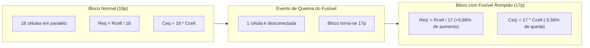
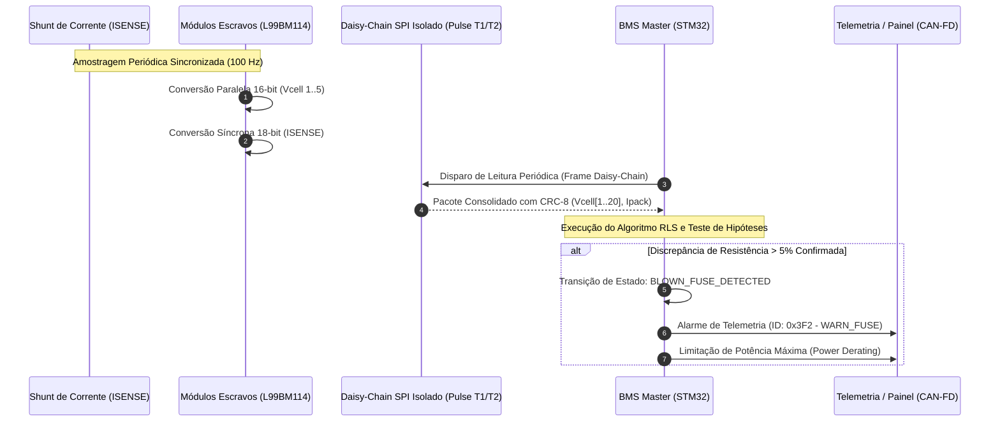
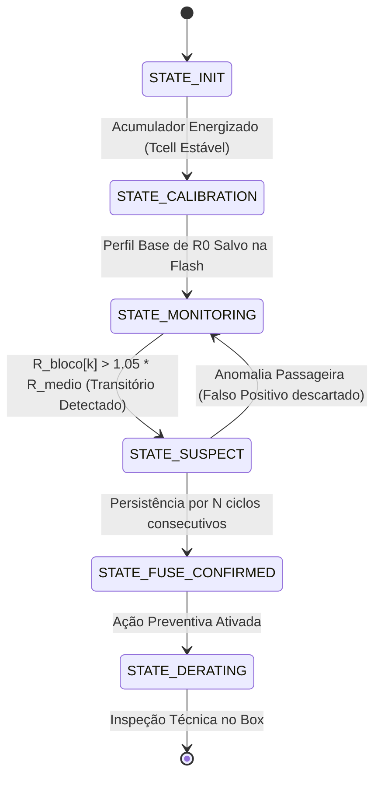

# 🔌 Plano de Implementação de Firmware: Detecção de Rompimento de Fusible Link (Método 1)
## Arquitetura BMS Master (STM32) & Slaves (L99BM114) — Formula ITA
**Projeto:** BMS Master - STM - V0 | **Data:** 22 de Outubro de 2026  
**Documento Técnico:** Plano de Engenharia e Algoritmos de Diagnóstico de Bateria

---

## 1. Visão Geral e Objetivo do Sistema

Em acumuladores de veículos de alta performance da Formula SAE Electric baseados em células cilíndricas (Li-Ion / LiFePO4), cada célula individual conectada em paralelo possui um *fusible link* (fio fusível ou trilha sacrificial em PCB) para proteção contra curtos-circuitos internos, conforme exigido pelas normas de segurança veicular (**Regras FSAE EV**).

Em uma arquitetura de alta paralelização (como a topologia **20s18p** da Formula ITA, com 18 células em paralelo por bloco):
- Quando um *fusible link* se rompe, as outras **17 células continuam conectadas em paralelo**, mantendo a tensão de circuito aberto ($OCV$) do bloco rigorosamente igual à dos demais blocos em repouso.
- **Uma medição estática de tensão (DC) é incapaz de detectar que uma célula foi desconectada.**

> **Objetivo Deste Plano:**  
> Implementar no firmware do futuro **BMS Master (STM32)** um algoritmo on-line e não invasivo (**Método 1**) que detecta o rompimento de qualquer *fusible link* através da análise dinâmica da **resistência interna equivalente ($R_{int}$)** e do **desvio de capacidade ($\Delta Q$)**, aproveitando a amostragem sincronizada de alta precisão entre tensão e corrente já nativa do chip escravo **ST L99BM114**.

---

## 2. Modelagem Matemática do Fenômeno Físico



### 2.1. Variação da Resistência Interna Equivalente ($R_{eq}$)
Seja $R_{cell}$ a resistência interna de cada célula e $N$ o número nominal de células em paralelo ($N = 18$).
A resistência interna equivalente do bloco íntegro é:
$$R_{eq} = \frac{R_{cell}}{N} = \frac{R_{cell}}{18}$$

Com o rompimento de um fusível, o número de células ativas cai para $N - 1 = 17$:
$$R_{eq}' = \frac{R_{cell}}{N - 1} = \frac{R_{cell}}{17}$$

A variação percentual relativa de resistência é:
$$\Delta R_{\%} = \frac{R_{eq}' - R_{eq}}{R_{eq}} = \frac{\frac{1}{17} - \frac{1}{18}}{\frac{1}{18}} = \frac{1}{17} \approx \mathbf{+5{,}88\%}$$

### 2.2. Efeito na Queda de Tensão sob Corrente de Tração ($V_{sag}$)
Em aceleração plena com corrente de tração $I_{pack} = 150\text{ A}$, assumindo células com $R_{cell} \approx 30\text{ m}\Omega$:
* **Bloco Íntegro (18p):**
  $$R_{eq} = \frac{30\text{ m}\Omega}{18} = 1{,}667\text{ m}\Omega \implies \Delta V_{18p} = 150\text{ A} \times 1{,}667\text{ m}\Omega = \mathbf{250{,}0\text{ mV}}$$
* **Bloco com Fusível Queimado (17p):**
  $$R_{eq}' = \frac{30\text{ m}\Omega}{17} = 1{,}765\text{ m}\Omega \implies \Delta V_{17p} = 150\text{ A} \times 1{,}765\text{ m}\Omega = \mathbf{264{,}7\text{ mV}}$$
* **Diferença de Tensão Detectável:**
  $$\Delta V_{delta} = \Delta V_{17p} - \Delta V_{18p} = \mathbf{14{,}7\text{ mV}}$$

Como o conversor ADC do L99BM114 possui erro total de medição $\le \pm 1{,}5\text{ mV}$ e resolução de $1{,}33\ \mu\text{V}$, uma discrepância de **$14{,}7\text{ mV}$** representa uma relação sinal-ruído ($SNR$) de quase **$10:1$**, perfeitamente distinguível por algoritmos de filtragem digital.

---

## 3. Arquitetura de Comunicação e Fluxo de Dados



---

## 4. Algoritmos de Detecção na ECU Master (STM32)

A ECU Mestre executará **três camadas complementares de análise** para garantir detecção confiável e imunidade contra falsos positivos:

### 4.1. Camada 1: Identificação de Parâmetros On-line via Mínimos Quadrados Recursivos (RLS)
Adota-se o modelo circuital de Thevenin de 1ª ordem para cada bloco $k \in [1..20]$:
$$V_{bloco,k}(t) = OCV_k(SOC) - I(t) \cdot R_{0,k} - V_{RC,k}(t)$$

O algoritmo **RLS com Fator de Esquecimento** ($\lambda = 0{,}98$) estima continuamente o vetor de parâmetros $\theta_k = [OCV_k, R_{0,k}]^T$:

```c
/**
 * @brief Atualização RLS para Estimação de Resistência Interna do Bloco
 * @param k      Índice do bloco (0 a 19)
 * @param I_pack Corrente medida sincronizada (A)
 * @param V_cell Tensão medida do bloco (V)
 */
void RLS_Update(uint8_t k, float I_pack, float V_cell) {
    // Só processa se houver dinâmica de corrente significativa (|dI/dt| > limiar)
    if (fabsf(I_pack - last_I_pack) < 5.0f) return;

    float phi[2] = { 1.0f, -I_pack };
    
    // Ganho de Kalman do RLS
    float P_phi[2];
    P_phi[0] = P[k][0][0] * phi[0] + P[k][0][1] * phi[1];
    P_phi[1] = P[k][1][0] * phi[0] + P[k][1][1] * phi[1];
    
    float denom = LAMBDA + (phi[0] * P_phi[0] + phi[1] * P_phi[1]);
    float K[2] = { P_phi[0] / denom, P_phi[1] / denom };
    
    // Erro de predição
    float y_pred = theta[k][0] * phi[0] + theta[k][1] * phi[1];
    float error = V_cell - y_pred;
    
    // Atualização dos parâmetros
    theta[k][0] += K[0] * error; // OCV estimado
    theta[k][1] += K[1] * error; // R0 estimado (Resistência Interna)
    
    // Atualização da matriz de covariância P
    // ...
}
```

### 4.2. Camada 2: Análise Estatística Inter-Blocos (Z-Score Relativo)
Para evitar que variações térmicas globais do acumulador (ex.: a bateria inteira aquecendo e reduzindo $R_{int}$ naturalmente) gerem alarmes falsos, o algoritmo calcula o **desvio relativo de cada bloco em relação à média do pack**:

$$\bar{R} = \frac{1}{20} \sum_{i=1}^{20} R_{0,i}$$
$$\sigma_R = \sqrt{\frac{1}{20} \sum_{i=1}^{20} (R_{0,i} - \bar{R})^2}$$
$$Z_k = \frac{R_{0,k} - \bar{R}}{\sigma_R}$$

* **Critério de Alarme:** Se um determinado bloco $k$ apresentar $Z_k > 3{,}5$ (desvio superior a $3{,}5$ desvios padrão) e $\frac{R_{0,k}}{\bar{R}} \ge 1{,}045$ continuamente por mais de **10 ciclos de tração**, o bloco é classificado como suspeito.

### 4.3. Camada 3: Validação Durante a Recarga (Coulomb Counting & $dV/dt$)
Durante a recarga lenta em corrente constante ($CC$ a $10\text{ A}$ no box):
- Um bloco de 17 células em paralelo acumula menos carga total ($Q = 17 \cdot Q_{cell}$).
- Sua derivada de tensão no final de carga $\frac{dV}{dt}$ crescerá mais cedo que a dos blocos de 18 células.
- O BMS Master cronometrará o tempo de balanceamento passivo: se o bloco $k$ demandar repetidamente **despejo de carga consideravelmente maior** para manter o alinhamento com os outros, confirma-se a perda de capacidade daquele paralelo.

---

## 5. Máquina de Estados de Diagnóstico (Firmware Master)



### Ações de Segurança ao Confirmar Falha:
1. **Derating de Corrente Máxima:** Limitar a corrente de descarga do inversor para $\frac{17}{18} \approx 94\%$ do valor de pico, garantindo que as 17 células restantes daquele bloco não ultrapassem a corrente máxima de dreno admissível da folha de dados da célula.
2. **Registro em Blackbox (Flash SPI):** Gravação com carimbo de tempo (Timestamp, Bloco afetado, $R_0$ medido, Temperatura e Corrente no instante do evento).
3. **Telemetria CAN:** Envio de mensagem de alerta prioritário para o painel do piloto e telemetria de box (`WARN_BLOWN_FUSE`).

---

## 6. Requisitos de Hardware para a Placa BMS Master (STM32)

Ao projetar o hardware do **BMS Master - STM - V0**, os seguintes circuitos e periféricos deverão ser contemplados:

| Bloco de Hardware | Especificação Recomendada | Função no Algoritmo |
| :--- | :--- | :--- |
| **Microcontrolador** | **STM32G474** ou **STM32F407** (Cortex-M4 com FPU) | FPU necessária para rodar as matrizes de ponto flutuante do RLS a 100 Hz. |
| **Transceiver Isolado** | **ST L9963T** ou **L99BM1T** | Converte o SPI padrão de 4 fios do STM32 no barramento diferencial isolado dos transformadores. |
| **Interface de Corrente** | Leitura redundante de Shunt de tração via CAN ou via L99BM114 | Sinal de corrente de referência para correlação $V/I$. |
| **Memória Não Volátil** | Flash SPI externa (W25Q32) ou EEPROM | Armazenamento do perfil de calibração de $R_0$ de fábrica do acumulador. |
| **Comunicação Veicular** | Transceiver CAN-FD com isolamento galvânico | Envio de mensagens de derating e telemetria de diagnóstico para o inversor e painel. |

---

## 7. Roteiro de Validação Experimental em Bancada

Antes de rodar no carro de corrida, a validação deste algoritmo deverá cumprir o seguinte plano de testes:

1. **Ensaio HIL (Hardware-in-the-Loop) com Simulador de Bateria:**
   - Injetar perfis de corrente do circuito de Endurance da Formula SAE gravados de telemetria anterior.
   - Simular um bloco com salto programado de $+5{,}88\%$ de impedância e validar o tempo de resposta do algoritmo.
2. **Ensaio Físico em Módulo 5S de Teste:**
   - Montar um módulo 5S com células reais em bancada.
   - Em um dos blocos, instalar uma chave de faca ou disjuntor em série com uma das 18 células.
   - Sob corrente de descarga controlada em banco de carga resistivo (ex.: $50\text{ A}$), abrir a chave simulando o rompimento do fusível.
   - Verificar se o firmware do Master acusa o alarme no tempo estimado ($< 2\text{ segundos}$ de condução contínua).
