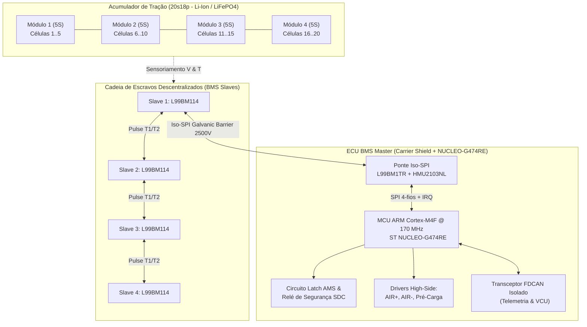
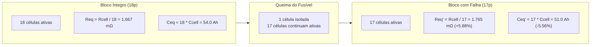
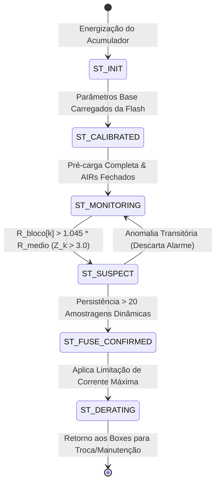
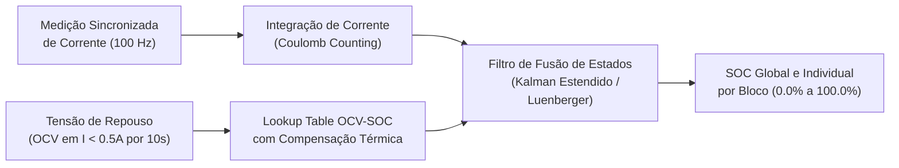
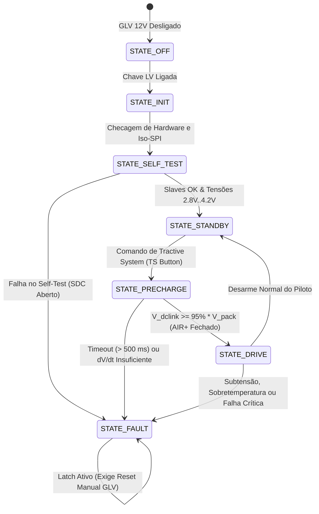
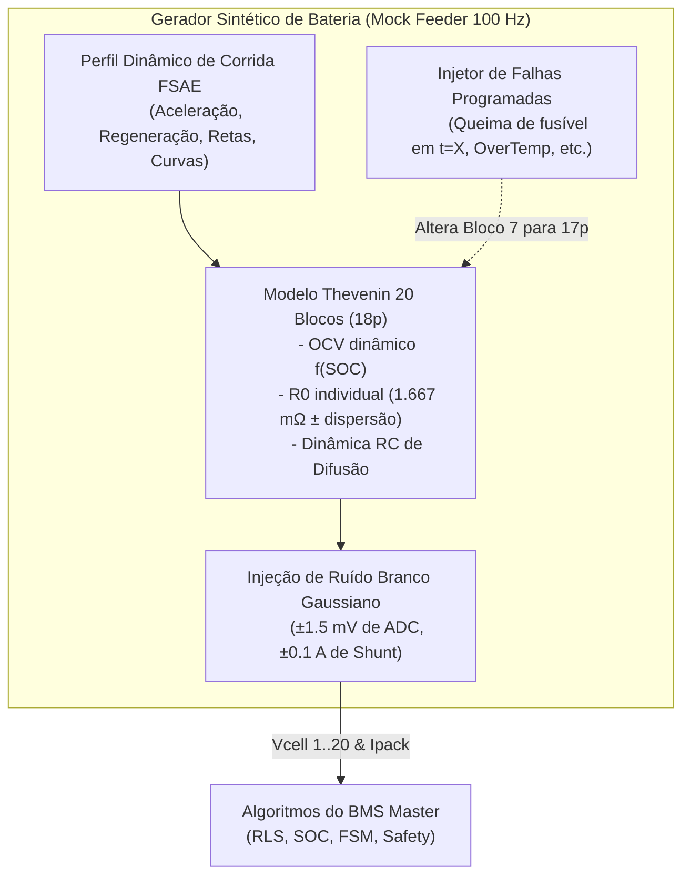
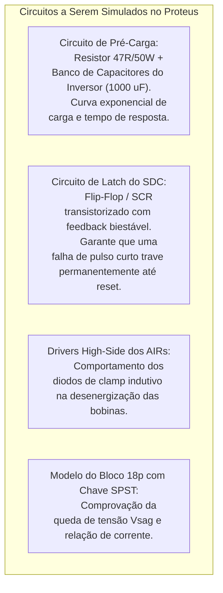
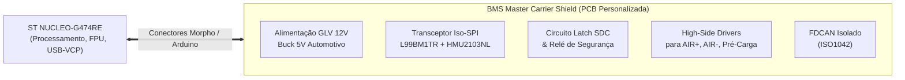
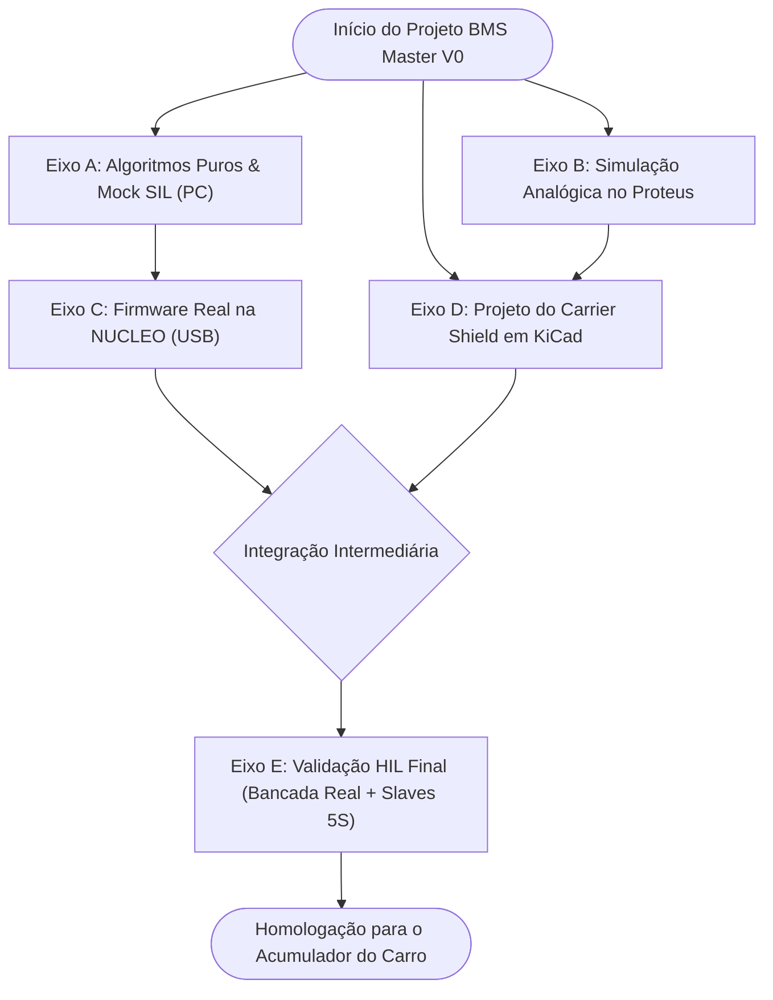

# 🏎️ Plano Mestre de Desenvolvimento e Arquitetura Consolidada — BMS Master V0
## ECU Central do Acumulador de Tração (20s18p) — Formula ITA (Formula SAE Electric)

**Projeto:** `BMS Master - STM - V0`  
**Data de Emissão:** 22 de Outubro de 2026  
**Status do Documento:** 🟢 **Documento Oficial de Engenharia e Arquitetura Unificada**  
**Classificação:** Especificação Técnica, Algoritmos, Hardware e Plano de Validação Contínua  

---

## 📑 Índice Geral

1. [Visão Geral, Contexto & Justificativa da Abordagem](#1-visão-geral-contexto--justificativa-da-abordagem)
2. [Topologia do Acumulador e Arquitetura do Sistema](#2-topologia-do-acumulador-e-arquitetura-do-sistema)
3. [Algoritmo de Detecção de Rompimento de Fusible Link (Método 1)](#3-algoritmo-de-detecção-de-rompimento-de-fusible-link-método-1)
   - 3.1. [Fenômeno Físico e Sensibilidade em Topologia 18p](#31-fenômeno-físico-e-sensibilidade-em-topologia-18p)
   - 3.2. [Camada 1: Identificação Paramétrica On-line via RLS](#32-camada-1-identificação-paramétrica-on-line-via-rls)
   - 3.3. [Camada 2: Análise Estatística Inter-Blocos (Z-Score)](#33-camada-2-análise-estatística-inter-blocos-z-score)
   - 3.4. [Camada 3: Validação Térmica e de Recarga (Coulomb Counting & dV/dt)](#34-camada-3-validação-térmica-e-de-recarga-coulomb-counting--dvdt)
   - 3.5. [Máquina de Estados de Diagnóstico e Ações de Derating](#35-máquina-de-estados-de-diagnóstico-e-ações-de-derating)
4. [Algoritmos Centrais do BMS Master](#4-algoritmos-centrais-do-bms-master)
   - 4.1. [Cálculo de Estado de Carga (SOC) e Estado de Saúde (SOH)](#41-cálculo-de-estado-de-carga-soc-e-estado-de-saúde-soh)
   - 4.2. [Máquina de Estados Operacional (FSM Principal: Init, Precharge, Run, Fault)](#42-máquina-de-estados-operacional-fsm-principal-init-precharge-run-fault)
   - 4.3. [Limites Dinâmicos de Corrente (CCL / DCL)](#43-limites-dinâmicos-de-corrente-ccl--dcl)
   - 4.4. [Rotinas Mandatórias de Segurança (FSAE EV4.8 / EV8)](#44-rotinas-mandatórias-de-segurança-fsae-ev48--ev8)
5. [Estratégia de Sensoriamento Sintético (Arquitetura Mock Completa)](#5-estratégia-de-sensoriamento-sintético-arquitetura-mock-completa)
   - 5.1. [Motivação: Ausência de Telemetria no Carro Legado](#51-motivação-ausência-de-telemetria-no-carro-legado)
   - 5.2. [Gerador de Perfil de Corrida Formula SAE (Drive Cycle Dinâmico)](#52-gerador-de-perfil-de-corrida-formula-sae-drive-cycle-dinâmico)
   - 5.3. [Modelo Eletro-Térmico dos 20 Blocos Simulados](#53-modelo-eletro-térmico-dos-20-blocos-simulados)
   - 5.4. [Injetor Programado de Falhas e Transitórios (Fault Injection Engine)](#54-injetor-programado-de-falhas-e-transitórios-fault-injection-engine)
6. [Simulação de Hardware e Circuitos no Proteus VSM](#6-simulação-de-hardware-e-circuitos-no-proteus-vsm)
   - 6.1. [O que Simular no Proteus (Circuitos Analógicos de Segurança e Potência)](#61-o-que-simular-no-proteus-circuitos-analógicos-de-segurança-e-potência)
   - 6.2. [Modelo SPICE do Bloco com Queima de Fusível](#62-modelo-spice-do-bloco-com-queima-de-fusível)
   - 6.3. [Limitações do Proteus e Fronteira de Uso](#63-limitações-do-proteus-e-fronteira-de-uso)
7. [Projeto de Hardware: Carrier Shield para NUCLEO-G474RE](#7-projeto-de-hardware-carrier-shield-para-nucleo-g474re)
   - 7.1. [Arquitetura Modular Shield + Nucleo](#71-arquitetura-modular-shield--nucleo)
   - 7.2. [Subsistema Iso-SPI (L99BM1TR + HMU2103NL)](#72-subsistema-iso-spi-l99bm1tr--hmu2103nl)
   - 7.3. [Alimentação Automotiva GLV 12V -> 5V (ISO 7637-2)](#73-alimentação-automotiva-glv-12v---5v-iso-7637-2)
   - 7.4. [Circuito de Latch de Falha AMS & Relé SDC](#74-circuito-de-latch-de-falha-ams--relé-sdc)
   - 7.5. [Drivers High-Side de Contatores (AIR+, AIR-, Pré-Carga) & Feedback](#75-drivers-high-side-de-contatores-air-air--pré-carga--feedback)
   - 7.6. [Interface CAN-FD Isolada e Sensoriamento HV](#76-interface-can-fd-isolada-e-sensoriamento-hv)
   - 7.7. [Mapeamento de Pinos da NUCLEO-G474RE](#77-mapeamento-de-pinos-da-nucleo-g474re)
8. [Espinha Dorsal do Projeto & Ramificações de Desenvolvimento](#8-espinha-dorsal-do-projeto--ramificações-de-desenvolvimento)
   - 8.1. [Eixo A: Algoritmos Puros & Mock SIL (Software-in-the-Loop no PC)](#81-eixo-a-algoritmos-puros--mock-sil-software-in-the-loop-no-pc)
   - 8.2. [Eixo B: Validação de Circuitos Analógicos no Proteus](#82-eixo-b-validação-de-circuitos-analógicos-no-proteus)
   - 8.3. [Eixo C: Firmware em Bancada na Placa NUCLEO (Via USB / VCP)](#83-eixo-c-firmware-em-bancada-na-placa-nucleo-via-usb--vcp)
   - 8.4. [Eixo D: Projeto Eletrônico e Fabricação do Carrier Shield](#84-eixo-d-projeto-eletrônico-e-fabricação-do-carrier-shield)
   - 8.5. [Eixo E: Integração Final HIL (Carrier Shield + Slaves Reais + Bateria 5S)](#85-eixo-e-integração-final-hil-carrier-shield--slaves-reais--bateria-5s)

---

## 1. Visão Geral, Contexto & Justificativa da Abordagem

O projeto **BMS Master - STM - V0** é o cérebro eletrônico de gerenciamento e segurança do acumulador de tração do protótipo elétrico da **Formula ITA**, competindo sob as exigências do regulamento da **Formula SAE Electric (FSAE EV)**.

### Desafios de Engenharia Deste Ciclo:
1. **Ausência de Telemetria Legada:** O protótipo atual da equipe não possui registro de telemetria de pack nem slaves de bateria instrumentados em pista. Portanto, todo o desenvolvimento de firmware precisa ser viabilizado a partir de **dados sintéticos de alta fidelidade (Mock)**.
2. **Topologia Altamente Paralelizada (20s18p):** A presença de 18 células em paralelo por bloco inviabiliza a detecção de rompimento de fusível por medições estáticas de tensão contínua ($OCV$). A detecção precisa ser dinâmica, via identificação on-line de impedância ($R_{int}$) e desvio de capacidade ($\Delta Q$).
3. **Desenvolvimento Não Bloqueante:** A equipe não pode aguardar a fabricação das placas e a chegada de componentes físicos para iniciar e validar a lógica de controle. A arquitetura de software deve ser concebida em **camadas estritamente desacopladas**, permitindo testar algoritmos no computador hoje, validar o firmware em uma placa de desenvolvimento comercial (**ST NUCLEO-G474RE**) amanhã e integrar o shield de hardware sem modificar uma única linha dos algoritmos centrais.

Este documento unifica e substitui os documentos preliminares de arquitetura e do método de detecção de fusível, consolidando a espinha dorsal de engenharia de todo o sistema.

---

## 2. Topologia do Acumulador e Arquitetura do Sistema



### Especificações Elétricas Globais:
* **Configuração:** 20 blocos em série, cada bloco contendo 18 células em paralelo ($20\text{S}18\text{P} = 360$ células).
* **Tensão Nominal do Bloco:** $3{,}6\text{ V}$ (Faixa de operação: $2{,}8\text{ V}$ a $4{,}2\text{ V}$).
* **Tensão do Barramento HV:**
  * Mínima ($V_{min}$): $20 \times 2{,}8\text{ V} = \mathbf{56{,}0\text{ V}}$
  * Nominal ($V_{nom}$): $20 \times 3{,}6\text{ V} = \mathbf{72{,}0\text{ V}}$
  * Máxima de Carga ($V_{max}$): $20 \times 4{,}2\text{ V} = \mathbf{84{,}0\text{ V}}$
* **Corrente de Pico de Tração:** $150\text{ A}$ a $200\text{ A}$ ($8{,}3\text{ A}$ a $11{,}1\text{ A}$ por célula).
* **Corrente Contínua Típica:** $60\text{ A}$ a $90\text{ A}$.
* **Corrente de Recarga (Box):** $10\text{ A}$ a $15\text{ A}$ contínuos ($CC/CV$).
* **Barreira de Isolação:** Galvânica por transformadores de pulso automotivos (`HMU2103NL`), suportando tensão de ruptura $\ge 2500\text{ V}_{RMS}$ e creepage $\ge 4\text{ mm}$ na PCB.

---

## 3. Algoritmo de Detecção de Rompimento de Fusible Link (Método 1)

### 3.1. Fenômeno Físico e Sensibilidade em Topologia 18p

Em cada bloco de 18 células em paralelo, cada célula é protegida individualmente por um *fusible link* (fio de ligação fusível ou trilha sacrificial calculada para romper sob correntes de curto-circuito interno $\ge 30\text{ A}$).



#### Dedução Matemática do Aumento de Resistência:
Seja $R_{cell} \approx 30\text{ m}\Omega$ a resistência ôhmica interna média de cada célula individual:
* **Bloco Normal ($N = 18$):**  
  $$R_{eq} = \frac{R_{cell}}{18} = \frac{30\text{ m}\Omega}{18} = \mathbf{1{,}6667\text{ m}\Omega}$$
* **Bloco com 1 Fusível Rompido ($N' = 17$):**  
  $$R_{eq}' = \frac{R_{cell}}{17} = \frac{30\text{ m}\Omega}{17} = \mathbf{1{,}7647\text{ m}\Omega}$$
* **Variação Percentual Relativa ($\Delta R_{\%}$):**  
  $$\Delta R_{\%} = \frac{R_{eq}' - R_{eq}}{R_{eq}} = \frac{18 - 17}{17} = \frac{1}{17} \approx \mathbf{+5{,}882\%}$$

#### Impacto na Queda de Tensão em Aceleração Plena ($I_{pack} = 150\text{ A}$):
* Queda de tensão no bloco íntegro:  
  $$\Delta V_{18p} = 150\text{ A} \times 1{,}6667\text{ m}\Omega = \mathbf{250{,}0\text{ mV}}$$
* Queda de tensão no bloco com defeito:  
  $$\Delta V_{17p} = 150\text{ A} \times 1{,}7647\text{ m}\Omega = \mathbf{264{,}7\text{ mV}}$$
* **Discrepância Mensurável de Tensão ($\Delta V_{diff}$):**  
  $$\Delta V_{diff} = 264{,}7\text{ mV} - 250{,}0\text{ mV} = \mathbf{14{,}7\text{ mV}}$$

Como o conversor ADC de 16 bits do chip escravo **L99BM114** tem erro total de conversão $\le \pm 1{,}5\text{ mV}$ e resolução de $1{,}33\ \mu\text{V}$, uma discrepância de **$14{,}7\text{ mV}$** garante uma **Relação Sinal-Ruído ($SNR$) próxima a $10:1$**, perfeitamente detectável por filtros estatísticos e adaptativos.

---

### 3.2. Camada 1: Identificação Paramétrica On-line via RLS

Adota-se para cada um dos 20 blocos o modelo elétrico de Thevenin de 1ª ordem discretizado:
$$V_{k}(t) = OCV_k(t) - I_{pack}(t) \cdot R_{0,k} - V_{RC,k}(t)$$

O algoritmo de **Mínimos Quadrados Recursivos (Recursive Least Squares - RLS)** com fator de esquecimento exponencial ($\lambda = 0{,}98$) estima continuamente o vetor de parâmetros $\theta_k = [OCV_k, R_{0,k}]^T$ para cada bloco $k \in [0..19]$:

```c
/**
 * @brief Atualização RLS para Estimação On-line de Resistência Interna do Bloco
 * @param k      Índice do bloco avaliado (0 a 19)
 * @param I_pack Corrente de tração instantânea (A)
 * @param V_cell Tensão instantânea do bloco k (V)
 */
void RLS_Update_Block(uint8_t k, float I_pack, float V_cell) {
    // Vetor de regressores: phi = [1, -I_pack]^T
    float phi[2] = { 1.0f, -I_pack };

    // Só executa o passo adaptativo se houver dinâmica de corrente significativa
    // para evitar divergência de covariância em repouso
    if (fabsf(I_pack - last_I_pack) < 3.0f) return;

    // 1. Ganho de Kalman do RLS: K = (P * phi) / (lambda + phi^T * P * phi)
    float P_phi[2];
    P_phi[0] = P[k][0][0] * phi[0] + P[k][0][1] * phi[1];
    P_phi[1] = P[k][1][0] * phi[0] + P[k][1][1] * phi[1];

    float denom = LAMBDA_RLS + (phi[0] * P_phi[0] + phi[1] * P_phi[1]);
    float K[2] = { P_phi[0] / denom, P_phi[1] / denom };

    // 2. Erro de predição a priori
    float y_pred = theta[k][0] * phi[0] + theta[k][1] * phi[1];
    float error = V_cell - y_pred;

    // 3. Atualização dos parâmetros estimados
    theta[k][0] += K[0] * error; // OCV estimado
    theta[k][1] += K[1] * error; // R0 estimado (Resistência ôhmica interna)

    // 4. Atualização da matriz de covariância P
    float P00 = P[k][0][0], P01 = P[k][0][1], P10 = P[k][1][0], P11 = P[k][1][1];
    P[k][0][0] = (P00 - K[0] * P_phi[0]) / LAMBDA_RLS;
    P[k][0][1] = (P01 - K[0] * P_phi[1]) / LAMBDA_RLS;
    P[k][1][0] = (P10 - K[1] * P_phi[0]) / LAMBDA_RLS;
    P[k][1][1] = (P11 - K[1] * P_phi[1]) / LAMBDA_RLS;
}
```

---

### 3.3. Camada 2: Análise Estatística Inter-Blocos (Z-Score)

Em baterias automotivas, variações de temperatura ambiente e aquecimento global por efeito Joule alteram a resistência ôhmica de todas as células simultaneamente (coeficiente térmico negativo típico de Li-Ion).  
Para evitar que o aquecimento do pack dispare alarmes falsos, o algoritmo calcula o desvio padronizado de cada bloco em relação à **média instantânea do pack**:

$$\bar{R} = \frac{1}{20} \sum_{i=0}^{19} R_{0,i}$$
$$\sigma_R = \sqrt{\frac{1}{20} \sum_{i=0}^{19} (R_{0,i} - \bar{R})^2}$$
$$Z_k = \frac{R_{0,k} - \bar{R}}{\sigma_R}$$

* **Critério de Detecção Robusta:**
  * Razão relativa: $\frac{R_{0,k}}{\bar{R}} \ge 1{,}045$ ($+4{,}5\%$ de resistência acima da média).
  * Desvio estatístico: $Z_k \ge 3{,}0$ (desvio extremo em relação aos demais blocos saudáveis).
  * **Filtro de Persistência:** A condição deve se manter verdadeira por **mais de 20 ciclos de aceleração consecutivos** (aproximadamente 2 segundos com $I > 20\text{ A}$).

---

### 3.4. Camada 3: Validação Térmica e de Recarga (Coulomb Counting & dV/dt)

Durante a recarga lenta em corrente constante ($CC$ de $10\text{ A}$ no box):
1. **Capacidade Reduzida:** O bloco defeituoso possui capacidade nominal útil reduzida em $5{,}56\%$ ($17 \times 3{,}0\text{ Ah} = 51{,}0\text{ Ah}$ contra $54{,}0\text{ Ah}$ dos demais).
2. **Derivada de Tensão ($dV/dt$):** No final da curva de carga ($SOC > 85\%$), a derivada $\frac{dV_k}{dt}$ do bloco de 17p acelera antes de todos os outros.
3. **Tempo de Balanceamento Passivo:** Ao atingir o limiar de balanceamento ($V > 4{,}15\text{ V}$), o resistor de sangria do escravo L99BM114 desse bloco precisará ficar ativado por muito mais tempo para equalizar com os blocos de 18p. Essa assimetria no balanço de carga confirma conclusivamente o defeito.

---

### 3.5. Máquina de Estados de Diagnóstico e Ações de Derating



#### Ações Automáticas de Segurança ao Confirmar Fusível Rompido:
1. **Derating de Corrente de Descarga (DCL):** O BMS envia frame CAN prioritário ao inversor limitando a corrente de descarga para $\frac{17}{18} \approx 94{,}4\%$ do limite nominal. Isso garante que as 17 células restantes daquele paralelo não ultrapassem seu limite de corrente contínua admissível.
2. **Alarme Prioritário no Painel do Piloto:** Envio de mensagem CAN `BMS_DIAG_FUSE_BLOWN` contendo o índice do módulo e do bloco afetado.
3. **Gravação Não Volátil:** Registro em Flash SPI (carimbo de tempo, bloco, $R_{0}$, temperatura e corrente no momento da queima).
4. **Não Desligamento Abrupto:** O regulamento FSAE não exige abertura imediata de contatores por fusível de célula isolada rompido. O carro mantém a dirigibilidade de forma segura para concluir a volta de instalação ou recolher aos boxes sem parar na pista perigosamente.

---

## 4. Algoritmos Centrais do BMS Master

### 4.1. Cálculo de Estado de Carga (SOC) e Estado de Saúde (SOH)

O cálculo de SOC adota uma estratégia híbrida em malha fechada:



* **Equação de Atualização de Carga:**  
  $$SOC(t) = SOC(t_0) - \frac{1}{Q_{nominal}} \int_{t_0}^{t} \eta_C \cdot I_{pack}(\tau) \, d\tau$$
  onde $\eta_C \approx 0{,}995$ é a eficiência de Coulomb.
* **Correção Automática por OCV:** Sempre que o veículo permanecer parado em repouso ($|I_{pack}| < 0{,}5\text{ A}$) por tempo $t > 15\text{ s}$, a estimativa de $SOC$ é corrigida suavemente pela tabela $OCV(SOC, T)$, eliminando o erro de deriva cumulativo do integrador.

---

### 4.2. Máquina de Estados Operacional (FSM Principal)

O BMS Master obedece à rigorosa sequência de controle de alta tensão estipulada pela FSAE EV:



1. **STATE_INIT / SELF_TEST:** Inicialização de periféricos do STM32, leitura dos 4 slaves L99BM114, verificação de integridade CRC, medição do IMD e validação de contatos auxiliares dos contatores (descolados).
2. **STATE_STANDBY:** Barramento HV isolado (AIRs e pré-carga abertos). Sistema pronto para ligar o Tractive System.
3. **STATE_PRECHARGE:**
   - Fecha **AIR-** (relé negativo).
   - Fecha **Relé de Pré-Carga** (em série com resistor de $47\,\Omega / 50\text{ W}$).
   - Monitora a elevação de tensão no DC-Link do inversor via medição diferencial isolada (`AMC1311`).
   - Critério de Sucesso: Quando $V_{dclink} \ge 0{,}95 \cdot V_{pack}$, aciona **AIR+** e abre o relé de pré-carga.
   - Timeout de Falha: Se $V_{dclink} < 0{,}95 \cdot V_{pack}$ após $500\text{ ms}$, aborta e abre tudo imediatamente (proteção contra curto-circuito no inversor).
4. **STATE_DRIVE:** Operação normal de corrida. Executa RLS, SOC, derating e comunicação CAN periódica (100 Hz).
5. **STATE_FAULT:** Disparo imediato do relé do SDC (Shutdown Circuit). Trava biestável por hardware acionada. Desliga todos os contatores. Exige intervenção manual do operador.

---

### 4.3. Limites Dinâmicos de Corrente (CCL / DCL)

O BMS Master calcula a cada $10\text{ ms}$ os limites máximos de corrente que o inversor tem permissão de drenar ou regenerar:
* **DCL (Discharge Current Limit):**
  $$DCL = \min \left( DCL_{tensão}(V_{min\_cell}),\ DCL_{temp}(T_{max\_cell}),\ DCL_{fuse\_derating} \right)$$
* **CCL (Charge / Regen Current Limit):**
  $$CCL = \min \left( CCL_{tensão}(V_{max\_cell}),\ CCL_{temp}(T_{min\_cell}) \right)$$

Estes valores são transmitidos ciclicamente via CAN para a VCU (Vehicle Control Unit) e Inversor, prevenindo atuação destrutiva antes que os limiares de segurança de corte do SDC sejam violados.

---

### 4.4. Rotinas Mandatórias de Segurança (FSAE EV4.8 / EV8)

| Parâmetro de Segurança | Limiar Crítico de Corte | Tempo Máximo de Resposta | Ação Mandatória |
| :--- | :---: | :---: | :--- |
| **Subtensão de Célula** ($V_{cell}$) | $< 2{,}80\text{ V}$ | $< 500\text{ ms}$ | Abertura imediata do SDC |
| **Sobretensão de Célula** ($V_{cell}$) | $> 4{,}20\text{ V}$ | $< 500\text{ ms}$ | Abertura imediata do SDC |
| **Sobretemperatura de Célula** ($T_{cell}$) | $> 60{,}0\ ^\circ\text{C}$ | $< 1000\text{ ms}$ | Abertura imediata do SDC |
| **Perda de Comunicação Iso-SPI** | Falha de frame $> 100\text{ ms}$ | $< 250\text{ ms}$ | Abertura imediata do SDC |
| **Falha de Isolamento HV/LV (IMD)** | Resistência de isolamento $< 500\,\Omega/\text{V}$ | Conforme norma ISO 6469 | Abertura imediata do SDC |
| **Solda de Contator (AIR Weld)** | Contato auxiliar fechado com bobina desligada | Imediato no Self-Test | Bloqueio total de energização |

---

## 5. Estratégia de Sensoriamento Sintético (Arquitetura Mock Completa)

### 5.1. Motivação: Ausência de Telemetria no Carro Legado

Como o carro atual não possui banco de baterias instrumentado nem sensores de corrente operacionais, **100% dos dados utilizados no desenvolvimento de firmware serão sintetizados através de um Módulo Mock de Engenharia de Bateria**.

Este módulo mock rodará:
- Como um gerador de vetores em arquivos C ou Python para testes unitários no PC (**SIL**).
- Como uma tarefa acionada por interrupção periódica de Timer ($100\text{ Hz}$) dentro da própria placa **NUCLEO-G474RE**, simulando em tempo real a existência dos 4 escravos e do sensor de corrente!



---

### 5.2. Gerador de Perfil de Corrida Formula SAE (Drive Cycle Dinâmico)

O gerador sintetiza o ciclo de corrente $I_{pack}(t)$ baseado no perfil real de uma prova de Endurance/Autocross:

```c
typedef enum {
    CYCLE_STANDBY,       // 0 A por 5 segundos
    CYCLE_LAUNCH,        // Rampa até 160 A (aceleração de largada)
    CYCLE_CORNER_BRAKE,  // Frenagem regenerativa (-35 A)
    CYCLE_APEX_COAST,    // Curva lenta (15 A)
    CYCLE_STRAIGHTAWAY,  // Aceleração máxima intermitente (120 A a 180 A)
    CYCLE_PIT_CHARGING   // Recarga lenta constante (-10 A)
} DriveCyclePhase_t;
```

---

### 5.3. Modelo Eletro-Térmico dos 20 Blocos Simulados

Cada um dos 20 blocos simulados possui suas variáveis individuais atualizadas a $100\text{ Hz}$:
1. **Dispersão Realista de Fabricação:**  
   - Resistência nominal: $R_{0,k} = 1{,}667\text{ m}\Omega \times (1 + \delta_{fab,k})$, onde $\delta_{fab,k} \sim \mathcal{N}(0, 0{,}01)$ (dispersão natural de $\pm 1\%$).
   - Capacidade nominal: $Q_{k} = 54{,}0\text{ Ah} \times (1 + \delta_{cap,k})$.
2. **Modelo Thevenin Dinâmico:**  
   $$V_{cell,k}(t) = OCV(SOC_k) - I_{pack}(t) \cdot R_{0,k} - V_{RC,k}(t) + e_{ADC,k}$$
   onde $e_{ADC,k} \sim \mathcal{N}(0, 0{,}75\text{ mV})$ é o ruído de conversão do ADC.
3. **Elevação Térmica por Efeito Joule:**  
   $$T_k(t + \Delta t) = T_k(t) + \frac{R_{0,k} \cdot I_{pack}^2(t) \cdot \Delta t}{C_{térmica}} - \frac{(T_k(t) - T_{amb}) \cdot \Delta t}{R_{dissipação}}$$

---

### 5.4. Injetor Programado de Falhas e Transitórios (Fault Injection Engine)

O mock contém gatilhos temporais para validar se as proteções de software respondem exatamente como especificado:

```c
typedef struct {
    float    time_trigger_s;       // Instante de disparo do teste
    uint8_t  target_block;         // Bloco alvo (0 a 19)
    enum {
        FAULT_NONE,
        FAULT_BLOW_FUSE,           // Aumenta R0 em +5.88% e reduz Ceq em -5.56%
        FAULT_CELL_UNDERVOLTAGE,   // Força Vcell < 2.80V para testar disparo do SDC
        FAULT_CELL_OVERVOLTAGE,    // Força Vcell > 4.20V
        FAULT_OVERTEMPERATURE,     // Rampa de temperatura até 62°C
        FAULT_ISOSPI_COMM_DROP     // Corta envio de dados para testar timeout
    } fault_type;
} FaultSchedule_t;

// Exemplo de cenário de teste de validação do RLS:
const FaultSchedule_t test_scenario[] = {
    {  0.0f,  0, FAULT_NONE },
    { 25.0f,  6, FAULT_BLOW_FUSE }, // Queima fusível no bloco 6 aos 25 segundos de corrida
    { 80.0f, 12, FAULT_OVERTEMPERATURE }
};
```

---

## 6. Simulação de Hardware e Circuitos no Proteus VSM

### 6.1. O que Simular no Proteus

O Proteus VSM é uma ferramenta excelente para validar **circuitos analógicos, transitórios $RC$ e lógicas de acionamento de potência**:



---

### 6.2. Modelo SPICE do Bloco com Queima de Fusível

No Proteus (ISIS Schematics), monta-se o bloco para validação física:
* **Fonte DC:** $3{,}6\text{ V}$.
* **Resistor Base ($R_{17p}$):** $1{,}765\text{ m}\Omega$.
* **Ramo do Fusível Paralelo:** Resistor de $30\text{ m}\Omega$ em série com uma chave analógica controlada por tensão (`SW-SPST`).
  - Chave fechada: $R_{eq} = 1{,}765\text{ m}\Omega \parallel 30\text{ m}\Omega = \mathbf{1{,}667\text{ m}\Omega}$ (Bloco 18p íntegro).
  - Chave aberta: $R_{eq} = \mathbf{1{,}765\text{ m}\Omega}$ (Bloco 17p com fusível rompido).
* **Fonte de Corrente:** Conecta-se uma fonte de corrente pulsada (`VPULSE` ou `PWL`) chaveando de $0\text{ A}$ a $150\text{ A}$. O osciloscópio virtual do Proteus mede instantaneamente o salto de $+14{,}7\text{ mV}$ na queda de tensão ao abrir a chave.

---

### 6.3. Limitações do Proteus e Fronteira de Uso

Para não desperdiçar horas de desenvolvimento tentando contornar ferramentas inadequadas:
1. **Sem modelos VSM dos CIs da ST:** Os CIs automotivos proprietários **L99BM114** e **L99BM1TR** não existem no Proteus como modelos de simulação digital.
2. **Suporte a Cortex-M4F:** O Proteus possui bibliotecas maduras para STM32F103 (Cortex-M3), mas não emula com fidelidade os aceleradores matemáticos CORDIC/FMAC nem a FPU avançada do **STM32G474RE**.
3. **Diretriz de Projeto:**  
   - Use o Proteus para **validar os subsistemas de hardware analógico e relés**.  
   - Para o algoritmo matemático e firmware do BMS, valide via **Mock em C no PC (SIL)** e diretamente na placa física **NUCLEO-G474RE na USB**!

---

## 7. Projeto de Hardware: Carrier Shield para NUCLEO-G474RE

### 7.1. Arquitetura Modular Shield + Nucleo

Em vez de projetar uma PCB única complexa contendo o microcontrolador, cristais, reguladores de núcleo e trilhas críticas de depuração, o projeto divide a placa em:
1. **Núcleo de Processamento:** Placa comercial pronta **ST NUCLEO-G474RE** (conector Morpho / Arduino Uno, gravador ST-Link V3 e porta serial VCP embutidos).
2. **Placa Base (Carrier Shield):** PCB dedicada de 4 camadas contendo as interfaces automotivas, conectores de engate rápido, barreira de isolação e circuitos de potência.



---

### 7.2. Subsistema Iso-SPI (L99BM1TR + HMU2103NL)
* **CI Transceptor:** `ST L99BM1TR` (encapsulamento SO-16N).
* **Transformador de Isolação:** `Pulse HMU2103NL` (grau automotivo AEC-Q200, isolamento $\ge 2500\text{ V}_{RMS}$).
* **Conector:** Molex Micro-Fit 3.0 de 4 pinos (padronizado com os escravos 5S).
* **Isolação Física:** Zona de exclusão de cobre (*keepout zone*) com espaçamento (*creepage*) $\ge 4{,}0\text{ mm}$ entre o terra do MCU e os sinais diferenciais dos escravos.

---

### 7.3. Alimentação Automotiva GLV 12V -> 5V (ISO 7637-2)
* **Tensão de Entrada:** $8\text{ V}$ a $16\text{ V}$ (nominal $12\text{ V}$ da bateria GLV).
* **Proteções:** Diodo Schottky de potência (anti-inversão), TVS automotivo de $1500\text{ W}$ (`SMBJ15CA`) e filtro passa-baixas LC em $\pi$.
* **Conversor DC-DC Step-Down:** CI automotivo síncrono (ex.: TI `LMR36015` ou ST `A6986`), fornecendo $5{,}0\text{ V} / 1{,}5\text{ A}$ contínuos com rendimento $> 88\%$ para alimentar a placa Nucleo pelo pino `E5V`.

---

### 7.4. Circuito de Latch de Falha AMS & Relé SDC
* **Conformidade FSAE EV4.8:** O relé de corte do Shutdown Circuit deve ser **Normalmente Aberto (NO)**.
* **Circuito Latch por Hardware:** Flip-Flop biestável (ou circuito transistorizado em SCR equivalente). Se o MCU acionar o pino `AMS_FAULT_SET` por $1\ \mu\text{s}$, a bobina do relé é desenergizada instantaneamente e a condição de falha fica travada, impedindo religamento até o acionamento de um botão de reset manual de baixa tensão.

---

### 7.5. Drivers High-Side de Contatores (AIR+, AIR-, Pré-Carga) & Feedback
* **Atuadores:** 2x Contatores de tração Gigavac/TE Connectivity de $12\text{ V}$ (bobinas com corrente de retenção de ~1 A) + 1x Relé de Pré-Carga.
* **CIs de Potência:** *High-Side Drivers* automotivos inteligentes (série ST `VN70xx` ou TI `TPS2Hxx`), dotados de proteção térmica, limitação de corrente e medição proporcional da corrente da bobina para diagnóstico de queima de relé.
* **Sensoriamento de Contatos Auxiliares:** Entradas digitais isoladas por optoacopladores para verificar fisicamente se os contatos de potência abriram de verdade (detecção de contato soldado).

---

### 7.6. Interface CAN-FD Isolada e Sensoriamento HV
* **Transceptor CAN:** TI `ISO1042` (isolação capacitiva integrada de $5000\text{ V}_{RMS}$ e suporte a CAN-FD até $5\text{ Mbps}$).
* **Medição de Alta Tensão (HV):** Divisores resistivos de alta impedância ($> 1\text{ M}\Omega$) medindo $V_{pack}$ e $V_{dclink}$, conectados a amplificadores de isolação de precisão `AMC1311` com saída analógica diferencial lida pelos ADCs da Nucleo.

---

### 7.7. Mapeamento de Pinos da NUCLEO-G474RE

| Periférico / Sinal | Pino NUCLEO (Morpho / Arduino) | Função do Pino |
| :--- | :---: | :--- |
| **SPI_MOSI / MISO / SCK** | `PB5` / `PB4` / `PB3` (SPI1) | Comunicação de dados com o L99BM1TR |
| **ISOSPI_CS / EN / IRQ** | `PA4` / `PC4` / `PA0` (EXTI0) | Controle e interrupção do L99BM1TR |
| **FDCAN_TX / RX** | `PB9` / `PB8` (FDCAN1) | Barramento CAN veicular isolado |
| **AMS_FAULT_OUT (SDC)** | `PB0` (GPIO Output) | Disparo da trava do circuito de segurança |
| **AIR_PLUS_EN / AIR_MINUS_EN** | `PC0` / `PC1` (GPIO Output) | Acionamento dos contatores principais |
| **PRECHARGE_EN** | `PC2` (GPIO Output) | Acionamento do relé de pré-carga |
| **AIR_AUX_FEEDBACK** | `PC3` / `PC5` (GPIO Input) | Leitura dos contatos auxiliares |
| **HV_MEAS_PACK / DCLINK** | `PA1` / `PA2` (ADC1/ADC2) | Leitura da tensão isolada do barramento |
| **DEBUG_VCP_TX / RX** | `PA2` / `PA3` (USART2 - STLink) | Terminal serial e telemetria no notebook |

---

## 8. Espinha Dorsal do Projeto & Ramificações de Desenvolvimento

A espinha dorsal foi estruturada para que as etapas de firmware, simulação, layout e bancada ocorram em **paralelo harmonioso**, garantindo entrega rápida e sem bloqueios:



---

### 8.1. Eixo A: Algoritmos Puros & Mock SIL (Software-in-the-Loop no PC)
* **Objetivo:** Criar e comprovar 100% da lógica matemática antes de tocar em qualquer placa.
* **Passos de Execução:**
  1. Escrever o módulo `alg_fuse_detect.c/.h` (RLS com fator de esquecimento exponencial $\lambda = 0{,}98$ e estimador de $Z$-score).
  2. Escrever o módulo `alg_soc.c/.h` (Coulomb Counting integrado + lookup table de OCV).
  3. Escrever o módulo `bms_mock_battery.c/.h` (Gerador de perfil de corrida FSAE e Thevenin com ruído de ADC de $\pm 1{,}5\text{ mV}$).
  4. Criar suite de testes em C (usando GCC / Unity / CMake no PC) injetando a queima de fusível em $t = 25\text{ s}$ e verificando se o algoritmo acusa o alarme sem falsos positivos.

---

### 8.2. Eixo B: Validação de Circuitos Analógicos no Proteus
* **Objetivo:** Garantir que os circuitos de potência e proteção da Carrier Board funcionem sem risco de queima de componentes.
* **Passos de Execução:**
  1. Simular o transitório de pré-carga ($RC$ com resistor de $47\,\Omega$ e banco de $1000\ \mu\text{F}$ do inversor).
  2. Simular o circuito de Latch biestável do SDC (garantir disparo sob pulso de microsegundos e rearme seguro).
  3. Simular os clamps indutivos de desenergização dos contatores de tração.

---

### 8.3. Eixo C: Firmware em Bancada na Placa NUCLEO (Via USB / VCP)
* **Objetivo:** Rodar o firmware real no microcontrolador STM32G474RE com FPU ativada a 170 MHz, mesmo antes da Carrier Board ser fabricada.
* **Passos de Execução:**
  1. Criar o projeto no STM32CubeIDE para a placa NUCLEO-G474RE.
  2. Configurar o Timer periódico (TIM6 a 100 Hz) que dispara o `bms_mock_battery`.
  3. Portar os algoritmos do Eixo A para a pasta do CubeIDE.
  4. Habilitar a USART2 conectada à USB do ST-Link integrado: imprimir ciclicamente no terminal do notebook (via Putty/Serial Studio) a matriz de resistências $R_{0,k}$, o status do fusível e o SOC.
  5. Validar o tempo de processamento por ciclo (garantir consumo de CPU $< 15\%$ nos 170 MHz).

---

### 8.4. Eixo D: Projeto Eletrônico e Fabricação do Carrier Shield
* **Objetivo:** Desenvolver e produzir a placa de circuito impresso que conecta a Nucleo ao carro e aos escravos.
* **Passos de Execução:**
  1. Captura do esquemático hierárquico no KiCad 10:
     - Bloco 1: Headers Morpho da NUCLEO-G474RE.
     - Bloco 2: L99BM1TR + transformador HMU2103NL + isolação galvânica.
     - Bloco 3: Regulador automotivo buck 12V $\to$ 5V com proteções ISO 7637-2.
     - Bloco 4: Latch do SDC e relé fail-safe NA.
     - Bloco 5: High-Side Drivers dos AIRs e Pré-carga.
     - Bloco 6: FDCAN isolado com transceptor ISO1042.
  2. Roteamento do layout de 4 camadas:
     - Top Layer: Sinais digitais rápidos e SPI.
     - Inner 1: Plano de Terra sólido (GND).
     - Inner 2: Plano de Alimentação (+5V e +12V).
     - Bottom Layer: Trilhas de potência dos contatores e sinais analógicos.
     - Creepage $\ge 4{,}0\text{ mm}$ na barreira galvânica.
  3. Geração de arquivos Gerber, Drill e BOM para envio à fabricação.

---

### 8.5. Eixo E: Integração Final HIL (Carrier Shield + Slaves Reais + Bateria 5S)
* **Objetivo:** Unir o firmware maduro ao hardware físico e comprovar a operação real em bancada de testes.
* **Passos de Execução:**
  1. Encaixar a placa NUCLEO-G474RE nos conectores da Carrier Board montada.
  2. Substituir no firmware a chamada do `bms_mock_battery` pelo driver real `bms_driver_l99bm1tr.c`.
  3. Conectar a cadeia Iso-SPI aos módulos escravos 5S com o CI L99BM114.
  4. Testar a leitura de tensões reais de células e corrente com banco de baterias de bancada.
  5. Realizar o ensaio físico de queima de fusível em bancada (chave de faca abrindo 1 célula sob carga resistiva de 50 A) e comprovar a atuação do derating em $< 2\text{ segundos}$.

---

*Este plano consolida a estratégia de desenvolvimento de hardware e software do BMS Master V0 da Formula ITA, servindo como documento de referência mestre para toda a equipe.*
